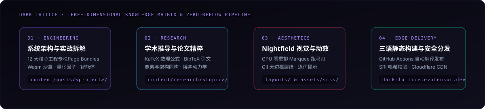
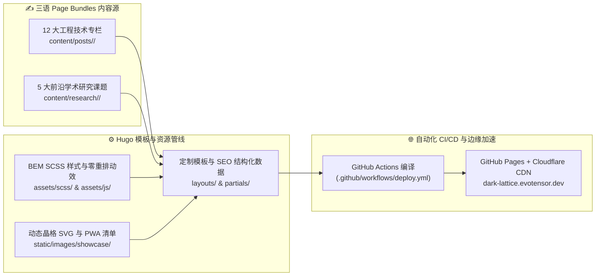

<div align="center">



# Dark Lattice (暗格)

**在点的格阵中，真相潜藏于黑暗 · Engineering. Research. Aesthetics.**

*面向研究者与极客开发者的 Nightfield 3D 沉浸式学术论文与系统工程门户。*

[](https://dark-lattice.evotensor.dev)
[](hugo.toml)
[](i18n/README.md)
[](docs/DESIGN_OVERVIEW.md)
[](LICENSE)

</div>

---

## ✨ 门户定位与设计愿景 (Overview)

`Dark-Lattice`（暗格）是 Evotensor 工作区的公开学术研究与深度工程技术展示门户（[**dark-lattice.evotensor.dev**](https://dark-lattice.evotensor.dev)）。站点基于自研的 **Nightfield（夜场）** 极客工业几何主题构建，围绕 **Engineering（系统工程）· Research（数理研究）· Aesthetics（知觉美学）** 三维知识矩阵，将硬核架构拆解、KaTeX 数理推导、BibTeX 学术引用与 GPU 加速的零重排微动效融为一体。

<div align="center">
  
</div>

---

## 🏛️ 核心特性矩阵 (Key Capabilities)

| 维度 | 特性模块 | 技术实现与视觉体验要点 | 设计规范锚点 |
| :---: | :--- | :--- | :--- |
| 📚 **学术级排版** | **KaTeX 数理公式与 BibTeX 引文** | 原生支持复杂多行矩阵、积分算子与学术文献自动编号引用，适配长篇数理论文阅读 | [`BLOG_DESIGN.md`](docs/BLOG_DESIGN.md) |
| 🌌 **Nightfield 美学** | **GII 无边框层级与逐词揭示** | 依靠深邃背景色阶（`--layer-0` ~ `--layer-3`）取代生硬边框，配合 GPU 加速 Marquee 跑马灯 | [`HOME_PAGE_DESIGN.md`](docs/HOME_PAGE_DESIGN.md) |
| 🌍 **三语无缝路由** | **中 / 英 / 日全站国际化 (i18n)** | 基于 Page Bundles 同目录多语言索引（`index.md` / `index.en.md` / `index.ja.md`）精准对齐 | [`I18N_DESIGN.md`](docs/I18N_DESIGN.md) |
| 📱 **全终端自适应** | **桌面宽屏、平板与手机竖屏零溢出** | 移动端自动切换垂直堆叠卡片、触控靶区 `≥ 44×44px`、底部兼容 `env(safe-area-inset-bottom)` | [`SCREEN_DESIGN.md`](docs/SCREEN_DESIGN.md) |
| 🔒 **静态安全防线** | **全量外部 CDN 资源 SRI 校验** | 所有外部脚本与样式强制绑定 SHA-384 `integrity` 哈希校验，配合 Cloudflare 边缘加速 | [`PROJECT_STRUCTURE.md`](docs/PROJECT_STRUCTURE.md) |

---

## 🔄 内容构建与全球边缘发布架构 (Publishing Pipeline)



---

## 🚀 快速开始与内容创作 (Quick Start)

### 1. 新增技术专栏或学术论文 Page Bundle
遵循 [`docs/CONTENT_GUIDE.md`](docs/CONTENT_GUIDE.md) 规范，在 `content/posts/` 或 `content/research/` 下按二级 `kebab-case` 路径创建文章束：

```text
content/posts/<project-slug>/<article-slug>/index.md       # 中文主文稿
content/posts/<project-slug>/<article-slug>/index.en.md    # 英文文稿
content/posts/<project-slug>/<article-slug>/index.ja.md    # 日文文稿
```

### 2. 提交变更并触发云端自动化部署
本地编辑完成后，运行规范校验并推送至 `main` 分支，即可由 GitHub Actions 自动完成 Hugo 构建与全站发布：

```powershell
# 1. 运行 Evopoiesis 文档与 README 合规体检
powershell -ExecutionPolicy Bypass -File ..\Evopoiesis\scripts\validate-readme.ps1 -Project "Dark-Lattice"
powershell -ExecutionPolicy Bypass -File ..\Evopoiesis\scripts\validate-docs.ps1 -Project "Dark-Lattice"

# 2. 提交并推送至 main 分支触发 GitHub Pages 自动部署
git add -A
git commit -m "docs: 新增研究课题文章与动态视觉资产"
git push origin main
```

---

## 📂 一级目录导航索引 (Directory Navigation)

| 一级目录 | 核心职责与资产概要 | 详细索引入口 |
| :--- | :--- | :--- |
| [`assets/`](assets/README.md) | 存放需经 Hugo Pipes 编译处理的 SCSS 样式体系（`_home.scss`、`_variables.scss` 等）与交互脚本 | [`assets/README.md`](assets/README.md) |
| [`content/`](content/README.md) | 存放全站三语 Markdown 内容源，包含 12 个工程专栏（`posts/`）、5 个研究课题（`research/`）与法律页面 | [`content/README.md`](content/README.md) |
| [`data/`](data/README.md) | 存放站点社交链接配置（`social.toml`）与 Google Search Console SEO 诊断导出数据 | [`data/README.md`](data/README.md) |
| [`docs/`](docs/README.md) | 存放视觉总览、首页交互、动效设计、国际化、SEO、Logo 规范及 `v1`~`v4` 原型演进档案 | [`docs/README.md`](docs/README.md) |
| [`i18n/`](i18n/README.md) | 存放中文（`zh.toml`）、英文（`en.toml`）与日文（`ja.toml`）三语界面词条翻译字典 | [`i18n/README.md`](i18n/README.md) |
| [`layouts/`](layouts/README.md) | 存放 Hugo 首页模板（[`layouts/index.html`](layouts/index.html)）、列表/单页模板、SEO 组件与 Sitemap 模板 | [`layouts/README.md`](layouts/README.md) |
| [`static/`](static/README.md) | 存放直接映射至站点根路径的静态资源，含动态 SVG 展示横幅（`images/showcase/`）、PWA 与图标 | [`static/README.md`](static/README.md) |

---

## 🛡️ 仓库治理与合规声明 (Governance & Legal)

本项目严格遵循 `Evopoiesis` 全域治理规范，根级合规声明四件套如下：

- 📄 **开源许可证**：[`LICENSE`](LICENSE)（MIT License）
- 🔒 **安全与 SRI 策略**：[`SECURITY.md`](SECURITY.md)（支持版本、私密漏洞上报与外部 CDN 资源 SRI 强制校验规约）
- ⚖️ **免责与学术声明**：[`DISCLAIMER.md`](DISCLAIMER.md)（技术与学术内容按现状提供、非金融投资建议与版权说明）
- 🤝 **贡献与创作指南**：[`CONTRIBUTING.md`](CONTRIBUTING.md)（双画像开发环境、Page Bundle 命名规范与提交前校验套件）
