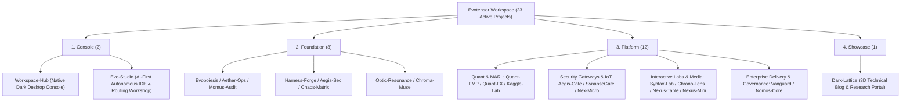

# Grand Unification of Workspace Architecture: Evopoiesis, the Four Orthogonal Archetypes, and the Storage-Compute-Edge Triad

> **Governing Hubs**: Evopoiesis (Autopoietic Lifecycle Platform) & Workspace-Hub (Desktop Navigation Console)  
> **Architectural Milestone**: Elimination of the "Ordinary" category, establishment of the Four Orthogonal Archetypes across 23 active projects, enforcement of the Storage-Compute-Edge Triad, and rollout of the mandatory SPEC-17 UI Terminal Adaptation baseline.  
> **Core Philosophy**: *"A system is born from the foundation of its rules; a system evolves through the metamorphosis of its structure."*

---

## 1. The Entropy Crisis: Why Multi-Project Workspaces Drift into Chaos

When an engineering workspace scales from a handful of experimental repositories to **more than 20 specialized projects**—spanning US equity and FX quantitative trading, Kaggle reinforcement learning, zero-trust penetration gateways, cloud-compiled ESP32 IoT firmware, legal/tax governance intelligence, tabletop HTML5 game matrices, and multi-agent theoretical hubs—three structural entropy crises inevitably emerge without a rigorous meta-architecture:

1. **Taxonomy Collapse and the "Ordinary" Catch-All Anti-Pattern**:
   In our earlier five-category taxonomy, an "Ordinary / General" category acted as a catch-all bucket. Over time, high-concurrency zero-attack-surface gateways (`Aegis-Gate`, `SynapseGate`), an experimental AI operating system (`Aura`), a 3D geek blog (`Dark-Lattice`), and legacy C#/Java teaching solutions were all dumped into this single category. Because their repository visibility (`PRIVATE` vs. `PUBLIC`) and cloud pipeline requirements were diametrically opposed, the governance specs accumulated awkward exception clauses—destroying the orthogonality of our classification system.
2. **Host Runtime Pollution and Runaway Cloud Billing**:
   Allowing projects to install local Python, Node.js, Rust, Java, or .NET toolchains on a lightweight host terminal (Surface Pro 9) quickly bloats storage with decenas of gigabytes of `.venv` and `node_modules` directories. Meanwhile, leaving long-running Cloud Run or GCE instances idle in the cloud creates persistent billing leaks.
3. **Fragmented Cross-Terminal UI Experiences**:
   Dashboards designed solely for wide desktop monitors frequently suffered from horizontal scroll overflow, undersized touch targets, or obscured bottom controls when accessed from mobile phones or tablets during emergency inspections.

To eradicate these failure modes at their root, we executed a workspace-wide architectural unification powered by **`Evopoiesis`**.

---

## 2. Eliminating the "Ordinary" Category: The Four Orthogonal Archetypes

We completely abolished the "Ordinary" category, retired redundant legacy repositories, and realigned all **23 active projects** into **Four Orthogonal Archetypes** with zero exception clauses:

| Archetype | Identifier | Repo Visibility | `.ops` Pipeline | Core Responsibility & Contract | Representative Projects |
| :--- | :---: | :---: | :---: | :--- | :--- |
| **Console** | `Console` | **PRIVATE** | **No `.ops`** | Desktop navigation hub, next-gen autonomous IDE workshop, local containerized compute & tiered model routing | `Workspace-Hub`, `Evo-Studio` |
| **Foundation** | `Foundation` | **PRIVATE** | **No `.ops`** | Cross-workspace theory, security auditing, UI/art tokens, cloud orchestration & meta-architecture; outputs host-level global `SKILL`s | `Evopoiesis`, `Harness-Forge`, `Aegis-Sec`, `Momus-Audit` (8 pillars) |
| **Platform** | `Platform` | **PRIVATE** *(+ Public `*-UI` repo)* | **Mandatory 3 Entrypoints** | End-user products, zero-trust gateways, and interactive laboratories; private source repo paired with an isolated public `*-UI` repo | `Quant-FMP`, `Quant-FX`, `Aegis-Gate`, `SynapseGate`, `Syntax-Lab`, `Nex-Micro` (12 platforms) |
| **Showcase** | `Showcase` | **PUBLIC** | On-Demand Check | Purely static technical blog and research portal deployed directly via GitHub Actions | `Dark-Lattice` |

---

## 3. The Physical Foundation: Storage, Ephemeral Compute & Edge Hosting Triad

Under the joint governance of `Evopoiesis` and `Aether-Ops`, every project adheres to the **Local Zero-Runtime Mandate** and the **Storage-Compute-Edge Triad**:

1. **Pure Zero-Runtime Host**:
   Installing third-party language runtimes or package managers on the host machine is strictly prohibited. All local automation relies exclusively on native Windows **PowerShell**, **BAT/CMD**, and our 61.5 KB native WinForms desktop console (`Workspace-Hub`) compiled via built-in `.NET Framework csc.exe`.
2. **Track 1 · Google Drive Data Center & Data Barrier**:
   All source code, design specifications, Parquet data lakes, and media vaults reside on Google Drive, guarded by the **Evopoiesis Data Barrier** in `.gitignore` to prevent any binary weights or datasets over 5MB from polluting Git history.
3. **Track 2 · Ephemeral GCP Spot Compute (`Destroy-on-Exit`)**:
   **Deploying long-running services on GCP (Cloud Run, always-on GCE VMs, GKE) is strictly forbidden.** GCP is used exclusively for short-lived tasks—Cloud Build compilation, model training, and heavy batch jobs—running on **Spot (preemptible) instances** at 60%–91% discounts that stream data over Google's internal backbone ($0 egress) and self-destruct immediately upon completion (`--boot-disk-auto-delete`), guaranteeing a **$0.00 idle cloud bill**.
4. **Track 3 · Two-Tier Repository Isolation & Zero-Cost Edge Hosting**:
   Every platform project keeps its source code in a private main repository (`QQDDTT/<Project>`) while publishing sanitized static frontend assets to a dedicated public secondary repository (`QQDDTT/<Project>-UI`) served via GitHub Pages and Cloudflare CDN (`*.evotensor.dev`).

---

## 4. SPEC-17: Mandatory Global UI Terminal Adaptation Standard

To guarantee flawless cross-device ergonomics, **SPEC-17** elevates terminal adaptation to a mandatory baseline across all non-foundation projects with user interfaces:
- **Explicit Terminal Declaration**: Every `AGENTS.md` must declare its target viewports (Desktop Workbench $\ge 1024\text{px}$, Tablet $768\text{px}\sim 1023\text{px}$, Mobile Portrait $< 768\text{px}$, Landscape Game Guard, or Dual-Screen Tabletop);
- **Zero Horizontal Overflow & Dynamic Viewport**: Enforcing `100dvh` / `100svh` and `Horizontal Overflow <= 0px` on mobile portrait screens;
- **44×44px Touch Target Gate & Safe-Area Insets**: Every interactive element must provide a hit area of at least $44 \times 44\text{px}$ with `env(safe-area-inset-*)` padding for notched displays and home indicators, verified end-to-end via Chrome DevTools device emulation during `Momus-Audit` red-team inspections.
