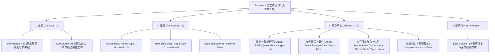
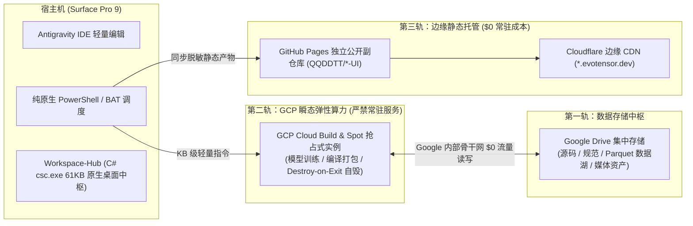

# 全域架构大一统：Evopoiesis 自生演化、四大正交分类体系与数据-算力-边缘三轨分离铁律

> **归属中枢**：Evopoiesis（自生演化平台） & Workspace-Hub（工作区导航中枢）  
> **变革里程碑**：废除“普通（Ordinary）”模糊分类、确立 23 个工程四大正交类别体系、落地三轨分离铁律与 SPEC-17 全域 UI 终端设备适配强制基线  
> **核心理念**：“系统之生，始于规则之奠基；系统之进，显于结构之蜕变。”

---

## 1. 熵增危机：多工程工作区为何会滑向“规则漂移”？

当一个技术团队或超级个体的工作区从三五个实验性仓库扩张至 **20 余个跨领域工程**（涵盖美股与外汇高频量化、Kaggle 强化学习推演、零信任穿透网关、ESP32 物联网固件云编译、法务财税治理智库、H5 聚会游戏矩阵以及多智能体理论中枢）时，如果缺乏强有力的顶层元架构约束，必然会遭遇三大熵增危机：

1. **分类边界坍缩与“普通（Ordinary）”垃圾桶效应**：
   在早期五大分类体系中，曾存在一个名为「普通 / 通用系统（Ordinary / General）」的兜底分类。随着工程演进，安全反向代理网关（`Aegis-Gate`、`SynapseGate`）、底层 AI 反应堆系统（`Aura`）、3D 极客静态博客（`Dark-Lattice`）以及早期的 C#/Java 教学代码库被一并塞入该分类。由于这些项目的仓库可见性（`PRIVATE` vs `PUBLIC`）与云端流水线需求截然相反，导致顶层规范被迫频繁打补丁（如“普通类私有安全豁免”、“带网络服务的普通项目”），丧失了架构分类的正交性。
2. **宿主机运行时污染与云端常驻账单失控**：
   若允许各项目在本地轻量宿主终端（如 Surface Pro 9）随意安装 Python、Node.js、Rust、Java、.NET 等多版本运行时，不仅磁盘迅速被数十 GB 的 `.venv` 与 `node_modules` 吞噬，且云端一旦遗留常驻的 Cloud Run 或 GCE 实例，将造成持续的闲置计费漏洞。
3. **跨终端 UI 体验割裂**：
   部分管理控制台与数据看板早期仅针对桌面宽屏设计，在手机竖屏或平板应急巡检时出现横向滑溢、按钮触控区过小或被全面屏底部手势条遮挡等缺陷。

为了从根源上终结上述无序状态，工作区正式启动了由 **`Evopoiesis`（自生演化平台）** 驱动的全域架构大一统改革。

---

## 2. 彻底清除“普通”分类：确立四大正交工程类别体系

在本次分类体系重构中，我们彻底废除了语义模糊的「普通」分类，并对存量项目进行了精准的去芜存菁与重新归位，形成了边界清晰、规则正交的 **四大标准类别（The Four Orthogonal Archetypes，共 23 个活跃工程）**：

| 类别名称 | 标识符 | 仓库可见性 | `.ops` 流水线 | 核心职责与架构契约 | 代表工程 |
| :--- | :---: | :---: | :---: | :--- | :--- |
| **主控** | `Console` | **PRIVATE** | **不设 `.ops`** | 工作区桌面导航控制台、下一代自主 IDE 工坊、本地容器化算力与分级模型路由底座 | `Workspace-Hub`、`Evo-Studio` |
| **基础** | `Foundation` | **PRIVATE** | **不设 `.ops`** | 全域基础理论、安全稽核、UI/美术规约、云算力编排与元架构中枢；**唯一职责是沉淀规范并向宿主机全局发布 `SKILL`** | `Evopoiesis`、`Harness-Forge`、`Aegis-Sec`、`Momus-Audit` 等 8 大工程 |
| **平台** | `Platform` | **PRIVATE** *(配公开 `*-UI` 副仓)* | **强制标准三入口** | 面向特定业务闭环、安全穿透网关或交互式演练的综合母机；源码私有，脱敏静态前端通过独立 `*-UI` 公开副仓库发布 | `Quant-FMP`、`Quant-FX`、`Aegis-Gate`、`SynapseGate`、`Syntax-Lab`、`Nex-Micro` 等 12 大平台 |
| **展示门户** | `Showcase` | **PUBLIC** | 按需校验 | 纯静态技术博客与前沿学术研究报告门户；主仓库直接公开并通过 GitHub Actions 自动部署 | `Dark-Lattice` |

通过这一收敛，原本需要靠“例外条款”维持的 `Aegis-Gate` 与 `SynapseGate` 正式回归 **【平台】** 序列，早期 `Aura` 退役并由 **【主控】`Evo-Studio`** 完美接替，早期两个 `TeachingSolution` 退役并升华为全新的 **【平台】`Syntax-Lab`**，实现了“零例外条款、100% 契约自治”。

---

## 3. 顶层物理基石：数据、算力与静态托管“三轨分离”铁律

在 `Evopoiesis` 与 `Aether-Ops` 的联合治理下，全工作区严格推行 **宿主机零外部运行时（Local Zero-Runtime）** 与 **三轨分离（Storage, Compute & Hosting Triad）** 架构：

1. **宿主机绝对纯净（Zero Local Runtime）**：
   宿主机严禁安装任何第三方语言运行时与包管理器；唯一允许的本地自动化工具为 Windows 原生内置的 **PowerShell**、**CMD/BAT**，以及系统自带 `.NET Framework csc.exe` 编译的 61.5 KB 超轻量桌面控制台 `Workspace-Hub`。
2. **第一轨 · Google Drive 统一数据屏障**：
   所有项目的文档、代码与大体积业务数据统一存放于 Google Drive，配合 `.gitignore` 中的 **Evopoiesis Data Barrier**，严禁任何超过 5MB 的二进制权重、行情 Parquet 或原始视频混入 Git 仓库。
3. **第二轨 · GCP 瞬态算力与“用完即毁（Destroy-on-Exit）”**：
   **绝对禁止在 GCP 部署 Cloud Run、GCE 常驻实例或 GKE 长期服务**。GCP 仅用于代码编译（Cloud Build）、量化模型训练与重度批处理，强制采用折扣高达 60%~91% 的 **Spot 抢占式实例**，任务结束自动回写结果至 Google Drive 并立即销毁实例，确保非任务期云端账单恒为 **`$0.00`**。
4. **第三轨 · 主从双仓物理隔离与边缘静态交付**：
   所有平台项目遵循“主仓私有存源码（`QQDDTT/<Project>`），副仓公开发静态（`QQDDTT/<Project>-UI`）”的双层隔离模型，配合 Cloudflare `CNAME` 挂载 `*.evotensor.dev` 子域名，在保障核心代码与网关策略绝对私密的同时，享受全球边缘节点的零成本高可用分发。

---

## 4. SPEC-17 全域 UI 终端设备适配必备规约

针对前端界面跨设备体验的一致性，`Evopoiesis` 正式颁布 **SPEC-17（Global UI Terminal Adaptation Mandatory Specification）**，将终端适配升格为除基础类与纯后端项目外的**强制验收红线**：

- **目标终端显式声明**：每个项目必须在 `.agents/rules/AGENTS.md` 中明确定义其支持的终端形态（PC 桌面宽屏操作台 $\ge 1024\text{px}$、平板触控屏 $768\text{px}\sim 1023\text{px}$、手机竖屏瀑布流 $< 768\text{px}$、横屏微游守卫或桌面双向双屏）；
- **零横向滑溢与动态视口铁律**：全面采用 `100dvh` / `100svh` 动态视口单位，移动端竖屏下严格保证 `Horizontal Overflow <= 0px`；
- **触控靶区门禁与异形屏安全区避让**：移动端所有可交互控件的物理命中热区必须满足 $\text{Hit Area} \ge 44 \times 44\text{px}$（间距 $\ge 8\text{px}$），固定底栏与浮窗强制注入 `env(safe-area-inset-*)` 避让灵动岛与底部手势条；
- **三大中枢闭环核验**：由 `Evopoiesis` 在立项/改造时注入规则，`Optic-Resonance` 在设计阶段提供响应式令牌，最终由 `Momus-Audit` 驱动 Chrome DevTools 仿真目标设备尺寸进行一票否决式实测。
