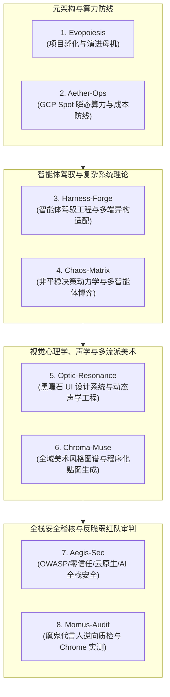

# 八大基础工程与全局 Skill 矩阵：从 Harness-Forge、Aegis-Sec 到 Chroma-Muse 与摩摩斯反脆弱审计

> **归属类别**：基础类型工程集群（Foundation Pillars · 共 8 大核心中枢）  
> **核心范式**：去 `.ops` 化纯粹性治理、单一权威规范源（Single Canonical Source）、宿主机全局唯一发布（`~/.gemini/config/skills/`）与 SHA256 強一致性校验

---

## 1. 告别“广播拷贝污染”：基础工程的纯粹性革命

在多项目智能体协同开发的早期阶段，曾出现过一种典型的反模式：为了让每个业务项目都能调用某项通用能力（例如 UI 设计令牌或复杂系统动力学审查），分发脚本会遍历整个工作区，将 `SKILL.md` 强行复制到二十几个子项目的 `.agents/skills/` 目录下。这种“项目级暴力广播”很快引发了严重的**版本漂移（Version Drift）**与跨项目技能混入污染。

在由 [16-foundation-project-transformation-guide.md] 确立的基础工程改造风暴中，我们确立了四大铁律：
1. **彻底去 `.ops` 化**：基础工程只产出理论文献、设计规约与全局 `SKILL`，不承载云端常驻服务，全面移除无效的 `.ops` 流水线脚本；
2. **单一权威规范源（Single Canonical Source）**：每个基础工程的 `.agents/skills/` 目录仅允许存放其自身权威产出的技能，严禁混入外部技能；
3. **宿主机全局唯一发布**：所有基础工程统一通过 `scripts/Install-GlobalSkill.ps1` 将技能单向发布至宿主机全局配置目录（`C:\Users\Nick\.gemini\config\skills\`），全工作区 23 个项目通过全局根目录透明继承，子项目内**零冗余副本**；
4. **SHA256 自动化合规门禁**：由 `Evopoiesis/scripts/validate-skills.ps1` 实时核验每个基础项目的命名空间前缀、Frontmatter 溯源声明、全局副本 SHA256 哈希一致性以及 `/Action` 快捷指令绑定。

---

## 2. 八大基础工程（Foundation Pillars）全景图谱

随着近期 **`Harness-Forge`**、**`Aegis-Sec`** 与 **`Chroma-Muse`** 三大新成员的正式孵化，Evotensor 工作区已形成覆盖**元规则、云算力、博弈论、智能体驾驭、全栈安全、视觉声学、美术生成与红队审计**的八大基础支柱：

| 基础工程 | 全局输出技能 (`Skill`) | 快捷指令 (`Action`) | 核心职能与文献资产规模 |
| :--- | :--- | :--- | :--- |
| **Evopoiesis** | `evopoiesis-create-project` `evopoiesis-update-project` | `/create-project` `/update-project` | 全工作区 17 项顶层规范制定、新建项目 7 步孵化与存量项目非侵入式演进母机 |
| **Aether-Ops** | `aether-ops` | `/orchestrate-ops` | GCP Cloud Build 与 Spot 抢占式短期算力调度、`Destroy-on-Exit` 零闲置成本防线与热点流量熔断 |
| **Harness-Forge** | `harness-forge` | `/harness-forge` | 收录 **38 部** 2024–2026 智能体驾驭工程权威文献，针对 5 类硬件设备（云端服务器/笔记本/手机/聚会双屏/MCU 单片机）改造目标项目设计文档 |
| **Chaos-Matrix** | `chaos-matrix` | `/audit-chaos-matrix` | 复杂时序动力学、非平稳分布偏移、多智能体博弈（MARL）与底层优化器设计文档审查中枢 |
| **Optic-Resonance** | `optic-resonance-ui` | `/design-ui` | 跨工程黑曜石 UI 设计令牌、5:3:1 色彩配比、**新增动态 BGM 编排与 Web Audio 合成按键音声学工程文献库** |
| **Chroma-Muse** | `chroma-muse-art` | `/chroma-muse-art` | 全域美术风格图谱、跨谱系差异化视觉方案涌现、高精 SVG 骨骼与 Shader 程序化材质生成中枢 |
| **Aegis-Sec** | `aegis-sec` | `/aegis-sec` | 沉淀 **5 大安全域 35 部权威文献精析**（代码安全、密码学与零信任、云原生与容器、供应链 CI/CD、AI 提示词注入防御） |
| **Momus-Audit** | `momus-audit` | `/momus-audit` | 摩摩斯对抗性红队审计中枢：专职寻找设计矛盾、核验测试真伪、驱动 Chrome DevTools 执行真实多终端探活 |

---

## 3. 新晋三大核心支柱深度解析

### 3.1 Harness-Forge：为狂野的大模型套上确定性工程“马具”
`Harness-Forge` 明确界定了 **Context Engineering（提示词）**、**Agentic Workflow（流程图）** 与 **Harness Engineering（运行时控制回路、物理沙盒隔离、传感器反馈与反脆弱自愈）** 的本质分野。其核心创新在于**硬件感知异构适配（Hardware-Aware Adaptation）**：
- 针对 `Quant-FMP` / `Kaggle-Lab`（云端瞬态服务器）：注入检查点续传与 Spot 抢占优雅退出契约；
- 针对 `Evo-Studio`（Framework Laptop 13 桌面工作站）：注入端云模型路由与 Docker 容器沙盒防线；
- 针对 `Nex-Micro`（ESP32/ESP8266 单片机）：注入零堆内存碎片（Static RingBuffer）、硬件看门狗（TWDT）与双分区 OTA 回滚架构。

### 3.2 Aegis-Sec：五大纵深防御域的全栈安全审判官
`Aegis-Sec` 将安全治理从“事后补救”前置到架构设计与代码落地的每一环：
- 覆盖 **OWASP Top 10:2025 / API Security**、**NIST SP 800-207 零信任架构与 Ed25519/mTLS 密钥生命周期**、**GCP IAM 最小权限与容器沙盒逃逸防护**、**SLSA 供应链可信构建**以及 **OWASP Top 10 for LLM（提示词注入、工具越权调用与敏感数据泄露阻断）**。

### 3.3 Chroma-Muse × Optic-Resonance：从像素贴图到声学共振的感官闭环
为了彻底消除 AI 生成界面与游戏资产的“同质化塑料感”，`Chroma-Muse` 建立了跨流派美术谱系（如新粗野主义瑞士网格、折纸层叠剪影、高精参数化机械骨骼 SVG），拒绝千篇一律的赛博霓虹模板；而 `Optic-Resonance` 则进一步拓展至**听觉维度**，通过纯原生 Web Audio API 实时合成毫秒级机械按键音与跟随业务状态流转的自适应 BGM 声景，无需加载外部大体积音频文件即可实现视听合一的沉浸体验。

