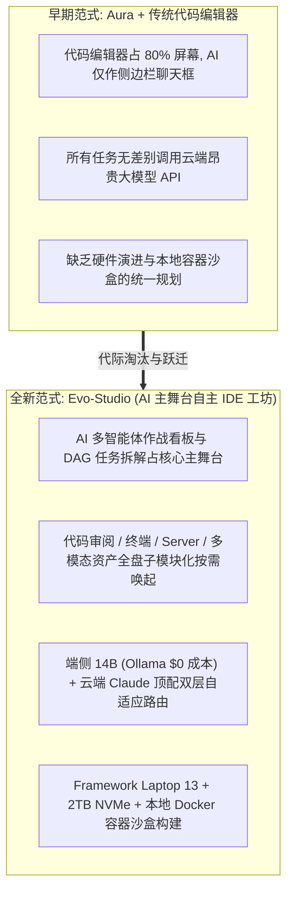

# 从 Aura 到 Evo-Studio 与 Syntax-Lab：AI 主舞台自主 IDE 工坊与纯前端时间旅行编程实验室的代际跃迁

> **演进主轴**：退役早期 `Aura` 反应堆系统与 `CSharp/JavaTeachingSolution` 传统代码库 $\to$ 全面跃迁至 **`Evo-Studio`（主控）** 与 **`Syntax-Lab`（平台）**  
> **协同矩阵**：联动 `Nex-Micro`（物联网 Web Serial 云编译）、`Nomos-Core`（法务财税治理智库）、`Quant-FMP`、`Quant-FX` v4.0、`Nexus-Mini` 等 12 大核心平台

---

## 1. 主控层代际跃迁：为什么 `Evo-Studio` 完美替代了 `Aura`？

在早期的探索中，`Aura` 曾试图构建一个基于 Rust 7-System 对称拓扑的独立 AI 代理反应堆操作系统。然而，随着多智能体工程实践的深入，我们意识到：**开发者与 AI 舰队协同的真正主战场，不在于另起炉灶维护一套脱离开发工作流的后台守护进程，而在于彻底重塑下一代自主 IDE 与算力路由工坊本身**。

为此，工作区正式退役并清理了 `Aura` 仓库及其关联域名，由主控层的 **`Evo-Studio`（演化工坊）** 全面接棒，实现了四大维度的代际跨越：

### 1.1 颠覆传统 IDE 交互比重：AI 成为绝对主舞台
传统 IDE（如 VS Code 衍生工具）依然延续着“文本编辑器占 80% 面积，AI 蜷缩在右侧窄栏”的旧时代布局。`Evo-Studio` 彻底反转了这一交互权重：
- **主舞台（Center Stage）**：直接呈现**多智能体作战态势看板、端侧任务拆解有向无环图（DAG）、实时验证流水线与云地算力监控**；
- **子模块化下沉（Sub-Modularized Panes）**：代码 Diff 审阅器、终端流、本地预览 Server 与多模态视觉资产全部收拢为受控子模块，仅在需要人工校准或验收时按需弹出。

### 1.2 端云双层分级认知路由（Tiered Cognitive Routing）
为了终结“杀鸡用牛刀”造成的云端 Token 额度浪费，`Evo-Studio` 构建了智能复杂度评估器：
- **L1 端侧零成本层（Local 14B via Ollama）**：意图分类、文件检索、简单脚本生成与任务 DAG 拆解全权由本地 NPU/GPU 运行的 14B 量化模型处理，边际成本为 `$0.00`；
- **L2 云端顶配直通层（Cloud Frontier Models）**：仅当遇到跨模块复杂架构推演、博弈算法设计或对抗性红队审计时，才精准路由至云端顶配推理模型。

---

## 2. 编程教育与机理推演的重生：`Syntax-Lab` 取代传统 `TeachingSolution`

工作区早期的 `CSharpTeachingSolution` 与 `JavaTeachingSolution` 采用传统的本地 `.sln` 与 Maven 多模块控制台工程。在“宿主机零外部运行时”的新规约下，这种必须依赖本地安装 JDK/.NET SDK 且仅能输出黑盒控制台文字的模式已完全过时。

我们彻底清理了这两个早期仓库，并创立了全新的核心平台 —— **`Syntax-Lab`（语法与架构实验室，`https://syntax.evotensor.dev`）**：

| 对比维度 | 早期 `CSharp / Java TeachingSolution` | 全新 **`Syntax-Lab`（语法与架构实验室）** |
| :--- | :--- | :--- |
| **运行依赖** | 需在本地安装 .NET SDK / Java JDK 编译运行 | **100% 纯前端零依赖**，打开浏览器即刻交互演练 |
| **语言视野** | C# 与 Java 割裂在两个孤立仓库 | **C# / Java / Rust / Go / TS 五语言同屏横向对比** |
| **呈现方式** | 静态源码阅读 + 控制台黑盒打印输出 | **时间旅行步进器（Time-Travel Stepper）+ 栈堆内存 SVG 动态画布** |
| **终端体验** | 仅限 PC 本地 IDE 调试 | **PC `100dvh` 三栏实验工作台 + 移动端自适应理论图谱卡片流** |

`Syntax-Lab` 内置四大核心实验舱：
1. **Pod 01 语言底层机理横向对比舱**：同屏对比值类型/引用类型装箱拆箱、`vtable`/`dyn Trait` 多态分派、反射元编程、分代 GC vs Rust 所有权生命周期、以及 `async/await` 状态机与 Go `G-M-P` 协程调度；
2. **Pod 02 算法与并发数据结构步进舱**：支持正向/逆向逐帧回放 AVL/红黑树/B+ 树分裂旋转、`HashMap` 树化、CAS 无锁环形缓冲区（RingBuffer）与动态规划状态转移；
3. **Pod 03 GoF 23 种设计模式工业级解构舱**：结合网关责任链、量化订单状态机等真实工程场景动态推演 UML 调用链；
4. **Pod 04 分布式与高并发系统架构仿真舱**：支持拖动 QPS 与故障率滑块，实时仿真令牌桶限流、熔断器三态流转与缓存穿透/击穿/雪崩防护。

---

## 3. 十二大核心平台（Platform Matrix）近期突破巡礼

除 `Syntax-Lab` 外，工作区其余核心平台也在近期完成了全面进化：

- **`Nex-Micro`（`micro.evotensor.dev`）**：全新孵化的 ESP 系列单片机（2×ESP32 + 1×ESP8266）物联网平台，打通“GCP 云端容器编译固件 $\to$ 浏览器 Web Serial API 零安装物理串口烧录 $\to$ 多节点协同遥测”全链路；
- **`Nomos-Core`（`nomos.evotensor.dev`）**：全新孵化的前沿部署公司法务、财务与商业化治理智库，内置动态股权成熟与稀释模拟器、研发费用加计扣除测算器与企业级 SLA 验收防线；
- **`Quant-FMP` & `Quant-FX` v4.0**：`Quant-FMP` 完成 15 年跨周期数据湖对齐、6,049 条深度行情增补与 13 项摩摩斯模型训练审计闭环（达标 99.9/100 质量门禁）；`Quant-FX` 重构升级至 v4.0 日内短周期策略并通过三轮对抗审计；
- **`Nexus-Mini` & `Chrono-Lens`**：`Nexus-Mini` 确立零远程通信三层标准架构并完成 `STYLE-57 × STYLE-39` 视觉重塑与全游戏 E2E 实机截图验证；`Chrono-Lens` 完成五大理念场域转场动画统一与移动端 $44\times 44\text{px}$ 触控热区加固；
- **`Aegis-Gate` & `SynapseGate`**：正式并入核心平台序列，作为全工作区零攻击面密码学激活网关与 AI 无感注入突触枢纽。

