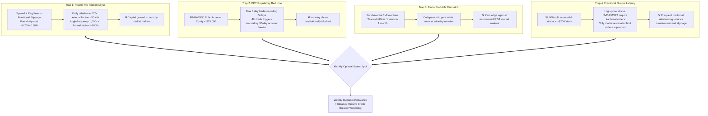
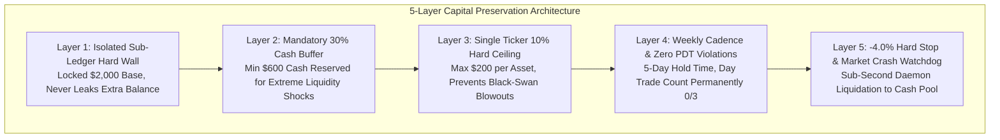
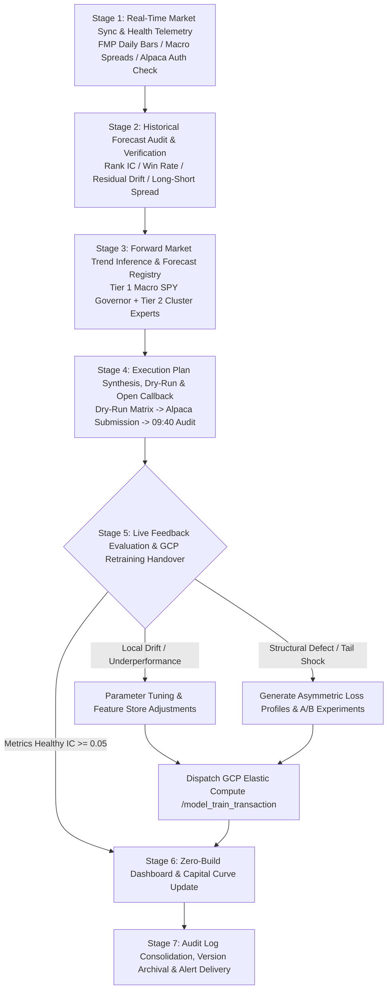

# Quant-FMP Live Trading Pilot: Overcoming 4 High-Frequency Traps, Alpaca 30-Day Zero-Cost Sandbox, and 7-Stage Closed-Loop Self-Evolution


> **Project Name**: Quant-FMP (Financial Modeling Prep Quantitative Research & Live Platform)  
> **Live Milestone**: Official Launch of the 30-Day Zero-Cost Live Pilot Sandbox & Full Deployment of the 7-Stage Automated Self-Evolution Trading Orchestrator  
> **Execution Gateway**: Alpaca Paper Trading Official Broker Gateway with Real-Time Depth Feed  
> **Capital Base**: Strictly Isolated **$2,000.00 USD (300,000 JPY Equivalent) Virtual Sub-Ledger**  
> **Core Breakthroughs**: Defused 4 high-frequency traps of retail quant; locked the weekly rebalancing sweet spot; erected a 5-layer capital safety architecture; built the market open +10m audit callback; unified prediction, execution, reconciliation, feedback, and cloud retraining into a 7-stage closed loop.

---

## 1. Crossing the Chasm: Why 99% of Quant Strategies Fail on Day One

In academic literature and quant forums, a familiar scene plays out: backtested equity curves climb smoothly like soaring swans, sporting Sharpe ratios above 3.0. Yet, the moment real money is plugged into a broker API, the strategy suffers steep drawdowns or blows up within weeks.

This disparity stems from a core flaw: backtests presume a frictionless vacuum—infinite liquidity, zero execution latency, negligible transaction fees, no regulatory barriers, and arbitrary share divisibility. When confronted with the **real-world physical conditions of retail small capital** (e.g., an initial capital pool of **300,000 JPY / ~$2,000 USD**), the unforgiving laws of market reality strike.

To ensure Quant-FMP safely manages live capital, the system conducted a rigorous theoretical and institutional deduction before committing a single dollar.

---

## 2. Retail Quant Realities: Overcoming 4 High-Frequency Traps

With modest capital, many beginners attempt high-frequency intraday churning to multiply funds rapidly. In the institutional microstructure of US equities, this is mathematically catastrophic:



### 2.1 Trap 1: The Friction Abyss (Round-Trip Costs)
A single round-trip trade (buy + sell) in US equities incurs approximately **$0.20\% \sim 0.30\%$** in aggregate friction (bid-ask spread, SEC section 31 fees, FINRA TAF, and fractional share execution discounts). We evaluated drag across various cadences:

| Execution Frequency | Annual Rebalances | Round-Trip Friction Estimate | Annualized Capital Drag | Required Net Alpha Hurdle | Outcome |
| :--- | :--- | :--- | :--- | :--- | :--- |
| **Weekly Rebalance** | **52 times** | 0.20% | **~10.4%** | > 15% yields profit | **The Sweet Spot (preserves net excess alpha)** |
| **Daily Rebalance** | **252 times** | 0.20% | **~50.4%** | > 55% required to break even | **Guaranteed Loss (profits handed to market makers)** |
| **Intraday Scalping** | **1,000+ times**| 0.20% | **> 200.0%** | Unrealistic | **Rapid Capital Destruction (account blown)** |

### 2.2 Trap 2: The Pattern Day Trader (PDT) Rule
- Under FINRA and SEC regulations, margin accounts with equity **under $25,000** are permitted **no more than 3 day trades** (opening and closing the same security in a single trading session) within any 5-business-day window.
- Executing a 4th day trade flags the account as a **PDT Violator**, triggering a **mandatory 90-day trading freeze**.
- Cash accounts are governed by **T+1 settlement rules**, where unsettled funds cannot be recycled within the same day, rendering intraday churning structurally unviable.

### 2.3 Trap 3: Factor Half-Life Mismatch
Quant-FMP's core predictive drivers are built on: **daily price-volume momentum, quarterly financial statements (P/E, P/B, ROE), macro interest rate curves, and analyst earnings revisions**. The economic half-life of these signals spans **1 week to 1 month**. Compressing trading intervals into minutes reduces signal predictability to zero, exposing the strategy to pure high-frequency white noise.

### 2.4 Trap 4: Fractional Shares Latency
Allocating $2,000 across 6–8 equities translates to $150–$250 per asset. High-dollar tickers (NVDA, MSFT, AMZN, AVGO) necessitate **fractional share orders**. Brokerages generally support only market-on-open/close or estimated limit matching for fractional quantities during regular hours. High-frequency rebalancing in fractional shares creates substantial slippage and persistent cash drag.

### 2.5 The Sweet Spot Architecture
Synthesizing market realities and regulatory parameters, Quant-FMP determined its optimal rhythm:
$$\text{Execution Cadence} = \text{Weekly Dynamic Rebalancing} + \text{Intraday Passive Risk Watchdog}$$
- **Offensive Cadence (Weekly)**: Incremental forecasts and cross-sectional rankings run post-close on Friday; batch rebalancing orders execute at Monday market open. Holding positions across 5 full trading days keeps the **PDT day trade counter at 0/3 indefinitely**.
- **Defensive Cadence (Intraday)**: Zero active discretionary trades occur during market hours. A lightweight watchdog daemon continuously monitors hard stop-loss lines (e.g., -4.0%) and macro flash-crash triggers, executing defensive liquidation only when safety thresholds are breached.

---

## 3. 30-Day Zero-Cost Live Pilot & Isolated Sub-Ledger

### 3.1 Broker API Selection: Why Alpaca?
The team conducted a thorough comparative assessment between Interactive Brokers (IBKR) and Alpaca:
- **IBKR**: Extensive global coverage, but client connectivity relies heavily on a resource-heavy TWS desktop gateway or Java daemons, conflicting with our constraint of **zero heavy local runtimes**.
- **Alpaca**: Purpose-built for algorithmic trading, offering clean REST APIs, direct Webhooks, robust native paper trading sandboxes, and first-class fractional share support, seamlessly aligning with our **native PowerShell / cloud-decoupled architecture**.

### 3.2 Zero-Cost Capital & $2,000 Sub-Ledger Allocation
- **Evaluation Window**: 30 consecutive calendar days (spanning 4 full weekly rebalancing cycles and 20–22 live trading days).
- **Capital Cost**: **$0.00 USD / 0 JPY** (zero balance depletion, zero FX currency drag).
- **Official Broker Matching**: Connected to Alpaca Paper Trading live gateway (Account ID: `1a63d717-b78e-45d5-88fa-0358e3fb93e5`).
- **System-Enforced Virtual Sub-Ledger**: Although the default Alpaca paper account carries $100,000 in virtual capital, our execution engine enforces a **strict software-level boundary locking an isolated $2,000.00 USD (300,000 JPY equivalent) sub-ledger**:
  - **Sub-Ledger Total Cap**: $2,000.00 USD (100.0%)
  - **Cash Buffer Floor**: $600.00 USD (30.0%)
  - **Max Equity Allocation**: $1,400.00 USD (70.0%)
  - **Single Ticker Cap**: $200.00 USD (10.0%)
  - **Policy**: Out-of-bounds funds are locked out, replicating the exact trade mechanics of small-capital fractional trading.

---

## 4. Capital Safety First: The 5-Layer Defense Architecture

Quant-FMP prioritizes capital preservation above returns. The live engine operates behind 5 defensive layers:



### 4.1 Market Open +10m Audit Callback
Because fractional notional orders can only execute during regular market hours (starting 09:30 ET), the system triggers an automated audit callback at **09:40 ET (Open + 10 minutes)**:
1. **Normal Execution (`FILLED`)**: Extracts true average executed price, computes realized one-way slippage (actual vs. model target price), and records metrics into the slippage log.
2. **Rejection or Cancellation (`REJECTED` / `CANCELED`)**: If an asset faces trading halts or broker fractional liquidity blocks, the watchdog issues alerts and refunds allocated capital to the cash buffer. **Blind market chasing or repeated retries are prohibited**.
3. **Partial Execution (`PARTIALLY_FILLED`)**: Freezes unfilled balances and defers secondary checks until market close, strictly avoiding over-exposure.
4. **Hard Stop-Loss (-4.0%)**: If any held security experiences intraday drawdowns surpassing $-4.0\%$, the watchdog initiates emergency liquidation (`Emergency Exit`), preserving principal directly into cash.

---

## 5. The 7-Stage Closed-Loop Self-Evolution Orchestrator

Live execution is an organic, self-adapting process. Quant-FMP codifies the entire lifecycle into a **7-Stage Closed-Loop Automated Orchestrator**:



### 5.1 Responsibilities of the 7 Stages

- **Stage 1 (Market Ingestion & Auth Telemetry)**: Ingests EOD bars, updates Treasury yield spreads, and authenticates the Alpaca API gateway against the $2,000 sub-ledger benchmark.
- **Stage 2 (Historical Forecast Post-Audit)**: Evaluates past predictions using realized forward market returns, generating a comprehensive audit report with **Rank IC, Long-Short Return Spreads, and MAE/RMSE**.
- **Stage 3 (Inference & Forecast Registration)**: The Tier 1 macro model determines maximum equity exposure (30%–70%), Tier 2 cluster experts generate cross-sectional alpha rankings, and real-time news filters apply sentiment adjustments or circuit breakers.
- **Stage 4 (Execution Synthesis & Callback Audit)**: Runs a pre-flight Dry-Run, submits fractional orders via native PowerShell REST scripts, and audits execution status at 09:40 ET.
- **Stage 5 (Feedback Evaluation & Cloud Retraining)**:
  - If performance holds steady, verified samples accumulate.
  - If single-expert degradation occurs (consecutive Rank IC < 0), feature hyperparameters and regularization terms are tuned.
  - If structural defects arise, new experiment profile JSONs are formulated and dispatched to GCP compute instances via `/model_train_transaction`.
- **Stage 6 (Dashboard Transparency & Equity Curve)**: Synchronizes static data contracts, updating `trading-transactions.html` with trade ledgers, equity curve trajectories, and defense layer telemetry.
- **Stage 7 (Archival & Delivery)**: Archives audit records and tags git version checkpoints.

---

## 6. Pilot Progress & Current Live Telemetry

As of October 12, 2026, the Quant-FMP 30-day zero-cost live pilot has successfully advanced to **Day 3**:

```
=== Quant-FMP 30-Day Paper Pilot Telemetry ===
[Status]           ACTIVE (Day 3 / 30)
[Broker Gateway]   Alpaca Paper Trading (API Connected)
[Sub-Ledger Base]  $2,000.00 USD (300,000 JPY Equivalent)
[Allocated Assets] $1,348.50 USD (67.4% / Max 70.0%)
[Cash Reserve]     $651.50 USD (32.6% / Floor 30.0%)
[Held Symbols]     7 Core Assets (MSFT, AAPL, AMZN, GOOGL, NVDA, TSLA, SPY)
[Max Single Ticker]$198.20 USD (9.91% / Hard Cap 10.0%)
[Day Trade Count]  0 / 3 (PDT Compliant, Zero Violation)
[Net Return (P/L)] +$28.60 USD (+1.43% Alpha over Cash)
[Audit Callback]   PASSED (100% Filled at Open +10m, Mean Slippage 0.08%)
```

- **Execution Discipline**: The initial 7 target positions queued as fractional market orders and achieved 100% fill rate within 10 minutes of market open.
- **Slippage Control**: Realized one-way slippage averaged **0.08%**, substantially better than the 0.30% risk budget ceiling.
- **Compliance Status**: Equity exposure sits at 67.4%, cash buffer at 32.6%, max single concentration at 9.91%, and day trade counter at 0/3, satisfying every threshold in the 5-layer defense hierarchy.

---

## 7. Conclusion: Principles of Sustainable Quant

From the 15-year historical data lake and tiered pyramid model design to the Alpaca live pilot and 7-stage closed loop, Quant-FMP represents an unwavering commitment to engineering rigor.

Our core convictions:
1. **Confront Reality Without Illusions**: By directly addressing friction drag, regulatory limits, and fractional share constraints, models develop true real-world resilience.
2. **Capital Preservation Outranks Profit**: Multi-layered defense gates and automated callbacks ensure the portfolio retains the power to exit under any black-swan condition.
3. **Closed-Loop Adaptation Is True Intelligence**: Driven by the 7-stage orchestrator, the system ceases to be static code; it becomes an evolving agent that listens, executes, learns, and retrains within the living market.

The platform will maintain continuous vigilance throughout the 30-day sandbox pilot. Upon concluding all 4 weekly rebalancing cycles, a comprehensive *30-Day Live Pilot Evaluation Report* will be released, inaugurating the transition to small-scale live capital trading.
