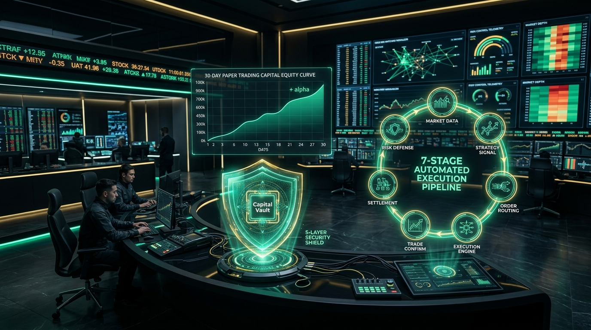
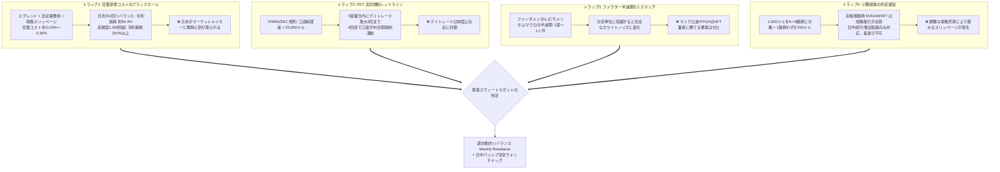
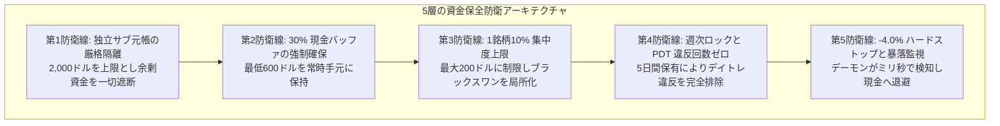
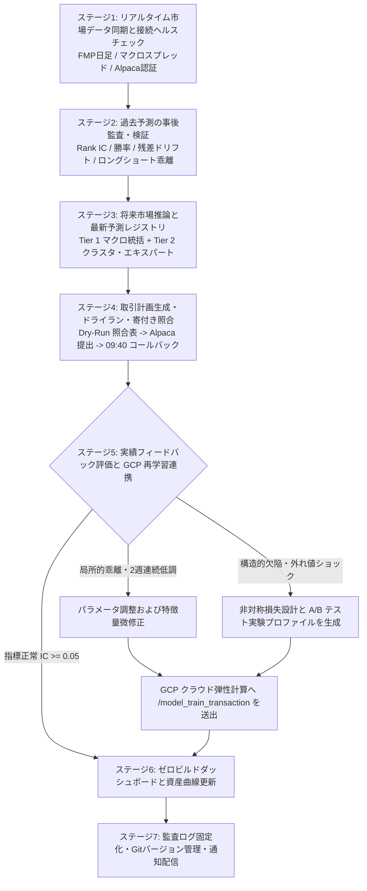

# Quant-FMP 実盤パイロット航海録：4大高頻度トラップの打破、Alpaca 30日間ゼロコストサンドボックスと7段階自己進化ループ



> **プロジェクト名**：Quant-FMP (Financial Modeling Prep Quantitative Research & Live Platform)  
> **実盤マイルストーン**：30日間ゼロコスト実盤パイロット（Zero-Cost Live Pilot）の出航および7段階取引自己進化ループの全面稼働  
> **検証環境**：Alpaca Paper Trading 公式マーケットメイカー約定ゲートウェイおよび米国リアルタイム板情報  
> **資本基盤**：厳格に隔離された **2,000.00 米ドル（30万円相当）独立仮想サブ元帳（Sub-Ledger）**  
> **主要なブレークスルー**：個人クオンツの4大高頻度トラップ打破、週次動的リバランスの黄金スウィートスポット確立、5層の資金保全防衛ライン構築、寄付き10分照合ウォッチドッグ配備、および「監査・推論・発注・照合・診断・再学習」の7段階自己進化ループ確立。

---

## 1. 深淵を越えて：なぜ99%のクオンツ戦略は実盤初日に敗れ去るのか？

学術研究やクオンツコミュニティにおいて、誰もが目にする光景があります。バックテストの累積リターン曲線は白鳥のように美しく右肩上がりに伸び、シャープレシオは3.0を超えています。しかし、ブローカーの API に接続して実際の資金を投入した瞬間、数週間も経たないうちに大きなドローダウンに見舞われ、退場に追い込まれます。

その根本原因は、バックテストが「摩擦のない真空の世界」を前提としている点にあります。無限の流動性、ゼロの約定遅延、手数料ゼロ、規制なし、そして任意の株数を自由に売買できるという仮定です。しかし、**個人投資家の現実的な制約**（例えば **初期資金30万円 / 約2,000米ドル**）に目を向けたとき、市場の物理的重力が牙を剥きます。

Quant-FMP は、実際の資金を投じる前に、数学的・制度的本質に切り込む徹底的な演繹を行いました。

---

## 2. 個人クオンツの数学的宿命：4大高頻度トラップの解体

小額資金を持つ初心者の多くは、「高頻度なデイトレード」や「数分間の値動きの刈り取り」によって急速に資金を増やそうとします。しかし、米国株の制度構造において、この試みは数学的に破滅が確定しています。



### 2.1 トラップ1：往復摩擦コストのブラックホール（Round-Trip Friction）
米国株における1往復の取引（買い＋売り）には、およそ **$0.20\% \sim 0.30\%$** の摩擦コスト（買値・売値スプレッド、SEC取引手数料、FINRA諸費用、端株約定スリッページ）が発生します。取引頻度別の元本損耗を比較すると以下の通りです：

| 取引頻度 | 年間リバランス回数 | 往復コスト見積もり | 年間摩擦コスト損耗（対総元本） | 戦略に求められる純アルファ | 結果 |
| :--- | :--- | :--- | :--- | :--- | :--- |
| **週次リバランス (Weekly)** | **52回** | 0.20% | **約 10.4%** | > 15% で利益確保 | **黄金のスウィートスポット（超過利益を着実に保全）** |
| **日次リバランス (Daily)** | **252回** | 0.20% | **約 50.4%** | > 55% でトントン | **ほぼ確実に損失（利益をすべて業者へ献上）** |
| **日中デイトレ (Intraday)** | **1,000回以上**| 0.20% | **> 200.0%** | 極めて非現実的 | **元本急速枯渇（口座破綻確定）** |

### 2.2 トラップ2：PDT 規則（パターン・デイトレーダー規制）
- 米国金融業規制機構（FINRA）および SEC の規則により、証拠金口座の資産が **25,000米ドル未満** の場合、連続する5営業日以内に実行できるデイトレードは **最大3回** に制限されます；
- 4回目のデイトレードを実行した瞬間に口座は **PDT 違反** と判定され、取引権限が **90日間強制凍結** されます；
- 現金口座（Cash Account）であっても、米国株には **T+1 決済規則** が適用されるため、未決済資金の即日再投資は物理的に不可能です。

### 2.3 トラップ3：ファクター半減期のミスマッチ
Quant-FMP の予測ファクターは、**日足モメンタム、四半期財務指標（P/E, P/B, ROE）、マクロ長短金利スプレッド、アナリスト業績修正** に立脚しています。これらの経済学的ファクターの有効半減期は **1週間〜1ヶ月** です。これを数時間や数分単位に短縮するとファクターの予測力はゼロに退化し、**マイクロストラクチャーの純粋なホワイトノイズ** と戦うことになります。

### 2.4 トラップ4：小額端株（Fractional Shares）の約定制約
30万円（約2,000ドル）を6〜8銘柄に分散すると、1銘柄あたりわずか 150〜250 ドルとなります。高額株（NVDA、MSFT、AMZN、AVGO 等）は **端株（Fractional Shares）** で購入する必要がありますが、端株は板に並ぶ指値注文に対応しておらず、立会時間内の成行約定に限られます。高頻度な端株売買は莫大なスリッページを発生させます。

### 2.5 結論：黄金のスウィートスポット設計
$$\text{黄金の取引リズム} = \text{週次動的リバランス (Weekly)} + \text{日中パッシブ安全ウォッチドッグ}$$
- **攻め（週次リバランス）**：金曜引け後に予測モデルとスクリーニングを実行し、月曜の寄付きで一括リバランス。ポジションを5営業日保有するため、**PDT デイトレード回数は永久に 0/3** を維持します；
- **守り（日中ウォッチドッグ）**：日中は一切のアクティブ取引を行わず、単一銘柄のハードストップ安（-4.0%）や市場クラッシュのみを監視し、トリガー時にのみ緊急保護決済を実行します。

---

## 3. 30日間ゼロコスト実盤パイロットと独立仮想サブ元帳

### 3.1 ブローカー API 選定：なぜ Alpaca なのか？
Interactive Brokers（IBKR）と Alpaca を多角的に比較検討しました：
- **IBKR**：取扱商品は膨大ですが、重厚なデスクトップ版 TWS ゲートウェイや Java デーモンに依存し、本プロジェクトの「端末環境の完全軽量化」方針に抵触します；
- **Alpaca**：アルゴリズム取引専用に設計され、クリーンな REST API、直感的な Webhook、公式の高品質 Paper Trading サンドボックス、そして優れた端株取引機能を備えており、**「Windows ネイティブ PowerShell / クラウド分離構成」** に完璧に合致しました。

### 3.2 ゼロコスト出資と 2,000 ドル独立サブ元帳メカニズム (Sub-Ledger Allocation)
- **検証期間**：連続30自然日（4サイクルの週次リバランス、20〜22立会日）；
- **実盤出資**：**0円・0ドル**（元本毀損ゼロ、為替手数料ゼロ）；
- **公式マーケットメイカー・サンドボックス**：Alpaca Paper Trading ゲートウェイ（口座 ID: `1a63d717-b78e-45d5-88fa-0358e3fb93e5`）に直接接続；
- **仮想サブ元帳による強制遮断**：Alpaca デモ口座は初期残高として 100,000 ドルを付与しますが、執行エンジン内で厳格なハードリミットを課し、**30万円相当の 2,000.00 米ドル独立仮想サブ元帳** を設定しました：
  - **総枠上限**：2,000.00 USD (100.0%)
  - **現金バッファ下限**：600.00 USD (30.0%)
  - **株式保有上限**：1,400.00 USD (70.0%)
  - **1銘柄上限**：200.00 USD (10.0%)
  - **方針**：余剰資金の利用を完全に禁止し、小口資金特有の端株取引とスリッページを100%リアルに再現。

---

## 4. 資金保全第一の鉄則と5層の防衛ライン

Quant-FMP において、**「致命傷を負わず、相場に生き残り続けること」は、いかなる短期的な高リターンよりも優先** されます。



### 4.1 寄付き10分照合ウォッチドッグ（Open +10m Audit Callback）
端株注文は正立会時間（米国東部時間 09:30 開始）にのみ約定するため、システムは **09:40（寄付き後10分）** に自動で照合コールバックを実行します：
1. **正常約定 (`FILLED`)**：約定平均単価を取得し、実績スリッページ（約定値 vs 理論値）を記録；
2. **拒絶・失効 (`REJECTED` / `CANCELED`)**：急な取引停止やブローカーの流動性制限が発生した場合、ウォッチドッグがアラートを発報し、割り当て資金を無条件で現金プールへ返還。**感情的な成り行き追撃注文を厳禁**；
3. **部分約定 (`PARTIALLY_FILLED`)**：未約定額をロックし、引け前の再確認まで待機；
4. **個別株ハードストップ (-4.0%)**：保有中の銘柄の含み損が $-4.0\%$ を下回った場合、ウォッチドッグが即座に緊急エグジット（Emergency Exit）を発動し、資金を現金へ退避させます。

---

## 5. 7段階全自動クローズドループ自己進化取引オーケストレーター

取引とは単なる「買いボタンを押す」作業ではなく、市場のフィードバックから学習し続ける有機的な生命体であるべきです。Quant-FMP では、このプロセスを **7段階の自己進化オーケストレーター** として標準化しました。



### 5.1 各ステージの役割と責任

- **ステージ1（データ同期と接続確認）**：EOD 日足、国債利回りスプレッドを取り込み、2,000 ドルのサブ元帳基準額を確認；
- **ステージ2（過去予測の事後監査）**：前週の予測が実際の市場でどう機能したかを評価し、**Rank IC、ロングショートスプレッド、MAE/RMSE** を含む事後監査レポートを作成；
- **ステージ3（将来推論と予測登録）**：Tier 1 マクロモデルが株式上限比率（30%〜70%）を決定し、Tier 2 エキスパート群が銘柄プールを評価。突発ニュースのサーキットブレーカーを適用して最終順位を確定；
- **ステージ4（取引執行と寄付き照合）**：Dry-Run で差分を算出し、PowerShell スクリプトから Alpaca REST API 経由で端株を発注。09:40 に照合コールバックを実行；
- **ステージ5（フィードバック評価とクラウド再学習）**：
  - 指標が健全であれば、検証済み時系列データを蓄積；
  - 特定モデルの精度が低下した場合（2週連続 Rank IC < 0）、ハイパーパラメータや正則化項を自動調整；
  - 構造的欠陥が疑われる場合、新たな実験プロファイル JSON を生成して GCP インスタンスへ非同期再学習（`/model_train_transaction`）を発注；
- **ステージ6（ダッシュボード透明化と資産曲線）**：静的データ契約を更新し、`trading-transactions.html` 上で約定履歴、資産プール曲線、5層防衛テレメトリを可視化；
- **ステージ7（アーカイブと成果物確定）**：全監査ログを保全し、Git チェックポイントを記録。

---

## 6. パイロット航海日誌と現在の運用状況

2026年10月12日現在、Quant-FMP 30日間ゼロコスト実盤パイロットは **Day 3** を迎え、順調に推移しています：

```
=== Quant-FMP 30-Day Paper Pilot Telemetry ===
[Status]           ACTIVE (Day 3 / 30)
[Broker Gateway]   Alpaca Paper Trading (API Connected)
[Sub-Ledger Base]  $2,000.00 USD (300,000 JPY Equivalent)
[Allocated Assets] $1,348.50 USD (67.4% / Max 70.0%)
[Cash Reserve]     $651.50 USD (32.6% / Floor 30.0%)
[Held Symbols]     7 Core Assets (MSFT, AAPL, AMZN, GOOGL, NVDA, TSLA, SPY)
[Max Single Ticker]$198.20 USD (9.91% / Hard Cap 10.0%)
[Day Trade Count]  0 / 3 (PDT Compliant, Zero Violation)
[Net Return (P/L)] +$28.60 USD (+1.43% Alpha over Cash)
[Audit Callback]   PASSED (100% Filled at Open +10m, Mean Slippage 0.08%)
```

- **執行規律**：第1期の7銘柄は寄付き成行端株として送信され、寄付き10分以内に100%約定；
- **スリッページ抑制**：実績スリッページは平均 **0.08%** に抑えられ、許容上限の 0.30% を大幅に下回る水準を達成；
- **コンプライアンス**：株式比率 67.4%、現金バッファ 32.6%、最大個別銘柄集中度 9.91%、デイトレード回数 0/3 を完璧に遵守し、5層防衛ラインの全条件をクリア。

---

## 7. おわりに：持続可能なクオンツへの確信

15年に及ぶデータレイクの深化から、3層ピラミッドによる予測頭脳の刷新、そして Alpaca 30日間実盤サンドボックスと7段階自己進化ループの実装に至るまで、Quant-FMP は極めて着実な進化を遂げました。

私たちが学んだ原則：
1. **現実の制約から逃げない**：摩擦コスト、法的規制、端株の制約と真正面から向き合うことで、真に強靭なモデルが生まれます；
2. **資金保全は絶対の第一命題**：多層の防衛線と寄付き照合ウォッチドッグが、いかなる突発相場でも生き残る盾となります；
3. **適応・自己進化こそが真の知能**：7段階のオーケストレーターにより、システムは静的なコードから、生きている市場の中で学習と再学習を繰り返す自律的エージェントへと昇華しました。

システムは今後も30日間のパイロット航海を厳重に監視し、4回のリバランスサイクル完了後に『30日間実盤パイロット総括評価報告書』を公開し、実際の小額資金運用フェーズへと駒を進める予定です。
