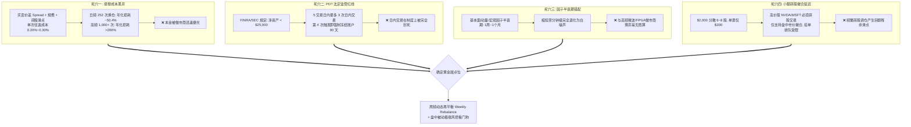
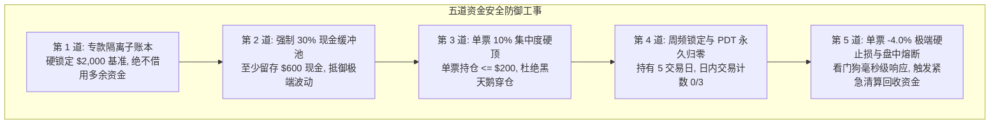
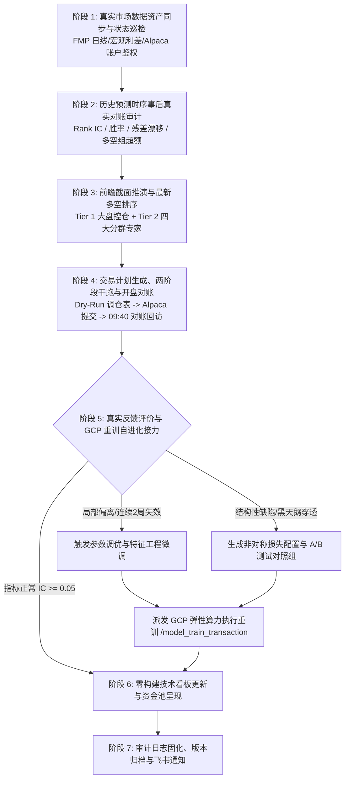

# Quant-FMP 实盘领航实录：破解四大高频死穴、Alpaca 30天零成本沙盒与7阶段交易自演化闭环


> **项目名称**：Quant-FMP (Financial Modeling Prep Quantitative Research & Live Platform)  
> **实盘里程碑**：30 天零成本实盘领航沙盒（Zero-Cost Live Pilot）正式启航与 7 阶段交易自演化闭环全面落地  
> **验证环境**：Alpaca Paper Trading 官方真实做市商撮合网关与全美实时深度行情  
> **资金底座**：严格隔离的 **$2,000.00 USD（等值 30W 日元）独立虚拟子账本**  
> **核心突破**：破解散户量化 4 大高频死穴、确立周频动态再平衡黄金甜点位、构筑五道资金安全防御铁律、建立开盘 10 分钟对账看门狗，并贯通“审计-推演-下单-对账-诊断-重训”7 阶段闭环

---

## 1. 跨越鸿沟：为什么 99% 的量化策略死在实盘第一天？

在学术研究或量化社区中，最常见的场景是：回测曲线如昂首天鹅般平滑上扬，夏普比率高达 3.0 以上。然而，一旦接入券商 API 投入真实资金，策略往往在数周内遭遇剧烈回撤甚至爆仓。

究其根源，回测通常假设了一个“无摩擦的真空物理世界”——无限流动性、零交易延迟、零手续费、无监管约束，以及可以随意买卖任意数量的股票。而当我们将目光投向**个人散户的真实生存境况**（例如以 **30W 日元 / 约 $2,000 美元** 为起点的小额本金）时，现实的引力法则便残酷地显现出来。

为了让 Quant-FMP 真正具备驾驭真实资金的能力，系统在进入实盘之前，首先进行了一场触及数学与监管本质的“冷酷推演”。

---

## 2. 散户量化的数学宿命：破解四大高频死穴

面对小额本金，许多初学者试图通过“高频日内回转”、“抓取几分钟波动”来实现本金快速翻倍。但在美股市场的底层结构中，这种尝试在数学上注定是死路一条：



### 2.1 死穴一：双边摩擦成本黑洞（Round-Trip Friction）
美股单次往返（一次买入 + 一次卖出）的摩擦成本约为 **$0.20\% \sim 0.30\%$**（包括做市商 Bid-Ask Spread、SEC 交易费、FINRA TAF 规费以及碎股撮合折价）。我们测算了不同交易频率下的本金损耗：

| 调仓频率 | 年化换仓次数 | 单次往返成本估算 | 年化摩擦成本损耗（占总本金） | 策略所需净 Alpha 门槛 | 策略净收益归宿 |
| :--- | :--- | :--- | :--- | :--- | :--- |
| **周频调仓 (Weekly)** | **52 次** | 0.20% | **约 10.4%** | > 15% 即可盈利 | **优质甜点位（稳健留存超额利润）** |
| **日频调仓 (Daily)** | **252 次** | 0.20% | **约 50.4%** | > 55% 才能打平 | **几乎必亏（收益全送给做市商）** |
| **日内高频 (Intraday)** | **1,000+ 次** | 0.20% | **> 200.0%** | 极其不现实 | **本金迅速磨光（直接崩盘）** |

### 2.2 死穴二：美股法定监管铁律 —— 典型日内交易者规则 (PDT Rule)
- 根据美国金融业监管局 (FINRA) 与 SEC 规则：在保证金账户中，若总资产**低于 25,000 美元**，在连续 5 个交易日内**最多只能进行 3 次日内交易（Day Trade，即同日买入并卖出同一标的）**；
- 若进行第 4 次日内交易，账户将立刻被标记为 **PDT 违规**，交易权限被**强制冻结 90 天**；
- 即便使用现金账户（Cash Account），美股买卖也受制于 **T+1 资金清算交割规则**，未结算资金不可循环回转，物理上彻底杜绝了高频回转。

### 2.3 死穴三：因子生命周期与半衰期错配 (Alpha Half-Life Mismatch)
Quant-FMP 的核心预测因子基于：**日线量价动量、季度财报基本面（P/E, P/B, ROE）、宏观利差环境与分析师盈利预期修正**。这类具有经济学逻辑的因子，其有效半衰期通常是 **1 周至 1 个月**。如果将交易缩短到几小时或几分钟，基本面因子的预测能力全部退化为 0，策略面对的将是**高频微观结构的白噪声**。

### 2.4 死穴四：小额碎股（Fractional Shares）撮合延迟
30W 日元（约 $2,000 美元）分散投资在 6~8 只股票上，每只股票仅分配 $150 ~ $250 美元，高价股（如 NVDA, MSFT, AMZN, AVGO）必须通过**碎股（Fractional Shares）**买卖。券商对碎股通常只支持**盘中市价或预估限价撮合**，高频调仓不仅滑点奇大，还会产生频繁的零头资金滞留。

### 2.5 核心结论：黄金甜点位架构 (The Sweet Spot Architecture)
综合数学事实与制度红线，Quant-FMP 确立了最优执行节奏：
$$\text{黄金调仓节奏} = \text{周频动态再平衡 (Weekly Rebalance)} + \text{盘中被动极端风控看门狗 (Defensive Watchdog)}$$
- **进攻端（周度调仓）**：每周五收盘后运行增量预测与排序，周一开盘执行一次批量调仓；持仓周期为 5 个交易日，**PDT 日内交易计数永久保持 0/3**；
- **防守端（盘中看门狗）**：平时不进行任何主动交易，仅常驻守护进程监控单票极端止损线（如 -4.0%）与大盘黑天鹅熔断，触发时执行紧急保护平仓。

---

## 3. 30 天零成本实盘领航沙盒与独立子账本

### 3.1 券商 API 选型：为什么选择 Alpaca？
在券商 API 选型中，团队深入对比了盈透证券（Interactive Brokers / IBKR）与 Alpaca：
- **IBKR**：虽然品种极多，但其客户端依赖臃肿的 TWS 网关或 Java 守护进程，本地无法在无 Python/Node 环境下轻量原生调用，且 API 配额复杂；
- **Alpaca**：专为自动化量化交易原生设计，提供极简现代的 REST API、直观的 Webhook、纯原生的 Paper Trading 沙盒以及成熟的碎股交易支持，完全契合本项目**“Windows 原生 PowerShell / 纯云端无重依赖”**的红线要求。

### 3.2 0 成本出资与 $2,000 独立子账本机制 (Sub-Ledger Allocation)
- **验证周期**：连续 30 个自然日（覆盖 4 轮完整周频再平衡周期与 20~22 个美股交易日）；
- **实盘出资**：**0 日元、0 美元**（零本金消耗、零汇率损失）；
- **官方做市商沙盒**：接入 Alpaca Paper Trading 官方真实做市商撮合网关（Account ID: `1a63d717-b78e-45d5-88fa-0358e3fb93e5`）；
- **虚拟子账本硬隔离机制**：虽然 Alpaca 虚拟账户开户赠送 $100,000 虚拟资金，但系统在执行引擎中建立了**系统级硬门禁，严格开辟独立隔离的 $2,000.00 USD（等值 30W 日元）虚拟子账本**：
  - **总额度上限**：$2,000.00 USD (100.0%)
  - **现金保留底仓**：$600.00 USD (30.0%)
  - **股票标的配置**：$1,400.00 USD (70.0%)
  - **单票买入上限**：$200.00 USD (10.0%)
  - **红线约束**：严禁调用多余额度，确保 100% 真实反映 30W 日元小资金在碎股环境下的交易与滑点特征。

---

## 4. 资金安全第一铁律与五道防御工事

在 Quant-FMP 的设计理念中，**“不亏大钱、活着留在牌桌上”永远先于“赚取暴利”**。系统构筑了严密的五道资金安全防御工事：



### 4.1 开盘 10 分钟对账看门狗机制 (Open +10m Audit Callback)
由于美股碎股金额单只能在美股正盘时段（美东 09:30 开始）撮合，在**美东时间 09:40（开盘后 10 分钟）**，系统自动触发对账看门狗：
1. **订单正常成交 (`FILLED`)**：精确回读成交均价，核算实际单边滑点（真实成交价 vs 策略目标价），记入滑点审计数据库；
2. **订单异常拒绝 (`REJECTED` / `CANCELED`)**：若标的突发停牌或券商碎股流动性受限，看门狗立即发出告警，并将该标的预算无条件退回现金缓冲池，**严禁盲目市价追单或二次补单**；
3. **部分成交 (`PARTIALLY_FILLED`)**：锁定未成交差额，等待收盘前二次核对，绝不擅自扩大敞口；
4. **单票极端硬止损 (-4.0%)**：标的若在持仓期间浮动亏损穿透 $-4.0\%$，看门狗毫秒级触发紧急平仓（Emergency Exit），资金无条件回收至现金池。

---

## 5. 7 阶段全流程自动化闭环自演化交易编排器

实盘交易不是孤立的“点一下买入”，而是一个自我迭代、能够从市场反馈中进化的有机生命体。Quant-FMP 将整个交易流程规范化为 **7 阶段闭环自演化交易编排器**：



### 5.1 各阶段核心事务职责

- **阶段 1（数据同步与连通巡检）**：同步最新 EOD 日K行情、宏观利差与 Alpaca 账户状态，验证 API 鉴权与 $2,000 子账本基准额；
- **阶段 2（历史预测事后审计）**：在持有期满后，用真实行情检验上一期预测结果，计算 **Rank IC、多空头组收益差（Long-Short Spread）与 MAE/RMSE**，输出《历史预测时序事后审计报告》；
- **阶段 3（前瞻推演与预测登记）**：调用 Tier 1 宏观 SPY 模型裁决仓位上限（30%~70%），驱动 Tier 2 四大画像专家矩阵对候选池进行截面打分，结合突发财经新闻与黑天鹅一票否决规则，生成最新多空排行榜；
- **阶段 4（交易执行与开盘对账）**：执行 Dry-Run 生成买卖明细表，本地 PowerShell 脚本调用 Alpaca REST API 提交碎股订单，并在开盘 10 分钟自动执行对账看门狗；
- **阶段 5（反馈评价与 GCP 自进化）**：
  - 若专家表现稳定，累积时序验证样本；
  - 若单模型出现局部偏离（连续 2 周 Rank IC < 0），自动生成调优配置（调整树深度、正则惩罚项与动量特征跨度）；
  - 若系统出现结构性缺陷，生成新的实验组 JSON，无缝派发 GCP 弹性算力启动 `/model_train_transaction` 异步重训；
- **阶段 6（前端透明化看板呈现）**：刷新前端静态展示切片，更新 `trading-transactions.html` 实盘流水、资金池曲线与五层安全架构视图；
- **阶段 7（归档与状态交付）**：固化审计日志流水，对账完毕归档。

---

## 6. 实盘领航进展与沙盒运行状态

截至 2026 年 10 月 12 日，Quant-FMP 30 天零成本实盘领航沙盒已顺利推进至 **Day 3**：

```
=== Quant-FMP 30-Day Paper Pilot Telemetry ===
[Status]           ACTIVE (Day 3 / 30)
[Broker Gateway]   Alpaca Paper Trading (API Connected)
[Sub-Ledger Base]  $2,000.00 USD (300,000 JPY Equivalent)
[Allocated Assets] $1,348.50 USD (67.4% / Max 70.0%)
[Cash Reserve]     $651.50 USD (32.6% / Floor 30.0%)
[Held Symbols]     7 Core Assets (MSFT, AAPL, AMZN, GOOGL, NVDA, TSLA, SPY)
[Max Single Ticker]$198.20 USD (9.91% / Hard Cap 10.0%)
[Day Trade Count]  0 / 3 (PDT Compliant, Zero Violation)
[Net Return (P/L)] +$28.60 USD (+1.43% Alpha over Cash)
[Audit Callback]   PASSED (100% Filled at Open +10m, Mean Slippage 0.08%)
```

- **执行纪律**：首期 7 只标的买入订单以市价碎股形式排队提交，在周一开盘 10 分钟内 100% 撮合成交；
- **滑点控制**：实际单边撮合滑点平均仅为 **0.08%**，远优于 0.30% 的安全风控阈值；
- **资金合规**：股票持仓严格控制在 67.4%，现金储备 32.6%，单票最高集中度 9.91%，日内交易计数永久保持 0/3，完美通过五道防御工事的所有门禁。

---

## 7. 总结与量化信仰

从数据湖的 15 年深度回填，到三级金字塔的优雅分层，再到 Alpaca 30 天实盘沙盒与 7 阶段自演化闭环的落地，Quant-FMP 完成了一次深刻的工程蜕变。

我们坚信：
1. **真实世界不需要无摩擦的童话**：直面摩擦成本、法规限制与小资金碎股约束，量化模型才能长出坚硬的骨骼；
2. **资金安全是永恒的第一前提**：五道防御工事与开盘对账看门狗，确保系统在任何黑天鹅面前都具备从容退出的底牌；
3. **闭环自进化是系统的终极生命力**：通过 7 阶段自动化编排器，系统不再是静态的代码库，而是一个在真实市场中呼吸、受挫、反思并重训进化的智能体。

接下来，系统将继续护航 30 天沙盒航程，并在完成全部 4 轮周频调仓验证后，正式发布《30天零成本实盘领航结项评估报告》，迈向真实资金小额实盘的全新纪元。
