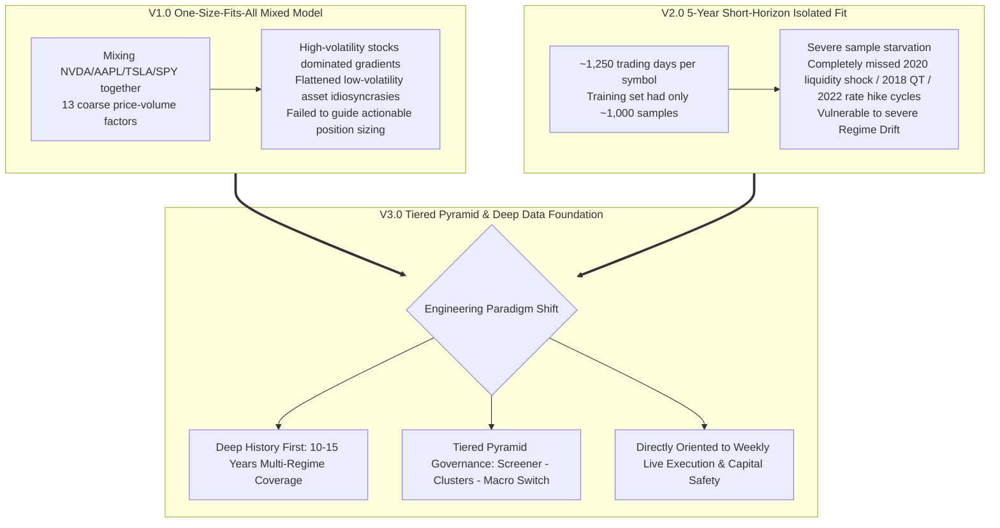
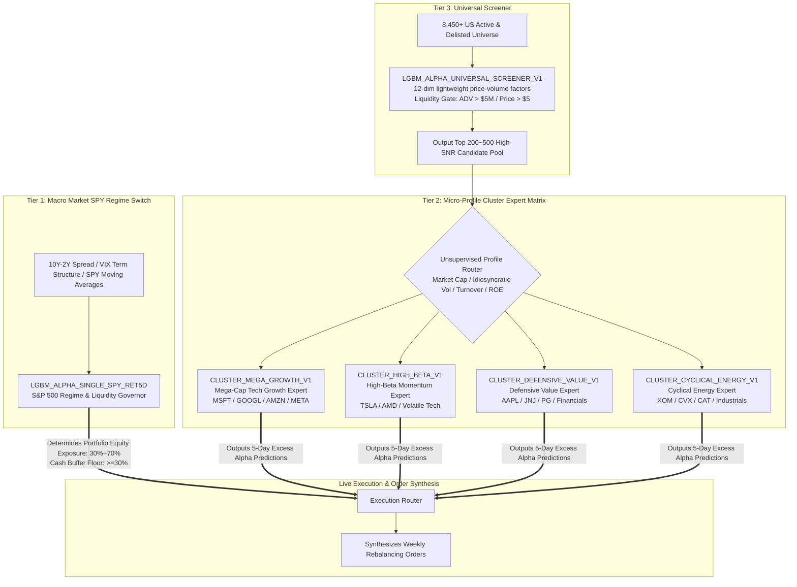
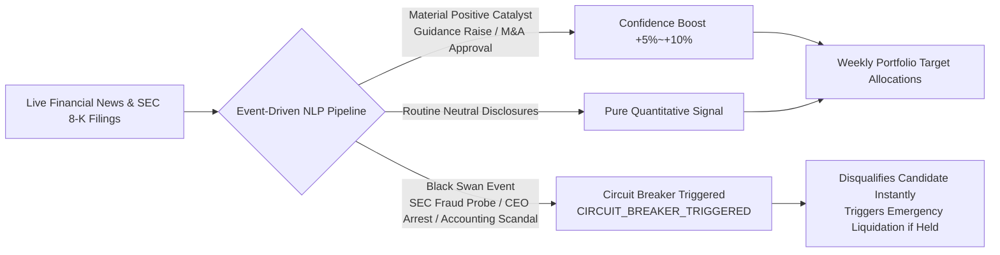

# Quant-FMP AI Brain Evolution: 15-Year Multi-Regime Data Lake, Corporate Actions, and Tiered Pyramid Expert Matrix


> **Project Name**: Quant-FMP (Financial Modeling Prep Quantitative Research & Live Platform)  
> **Evolution Phase**: Forecasting Engine V3.0 (Tiered Pyramid Cluster Architecture & Deep Historical Foundation)  
> **Milestones**: Deprecated naive mixed V1 and short-horizon V2 schemes; constructed a 15-year cross-cycle data foundation (2010–2026, 246K+ daily bars / 117K+ sample feature store); built corporate actions lake (Dividends & Splits); rolled out V3.0 Tiered Pyramid Expert Matrix with dynamic news event circuit breakers.  
> **Architecture Split**: Lightweight Host Control + Elastic Cloud Data Lake & Tree Model Compute + Zero-Build Transparent Dashboard.

---

## 1. Evolution Context & Lessons Learned: Why We Rebuilt the Brain

In quantitative time-series forecasting, the most dangerous illusion is high in-sample win rates fitted within an artificial greenhouse. During the early iterations of Quant-FMP (late September to early October 2026), the platform underwent two consecutive model generations that failed to withstand rigorous execution-driven inspection:



### 1.1 Pitfalls of the V1.0 Mixed Model (`LGBM_ALPHA_TOP8_RET5D_20260930_V1`)
Training semiconductors (NVDA), consumer electronics (AAPL), electric vehicles (TSLA), and index ETFs (SPY) inside a single LightGBM tree resulted in catastrophic gradient bias. Because the variance of NVDA and TSLA dwarfed that of AAPL and SPY, gradient descent focused almost entirely on the volatile extremes, flattening the subtle alpha patterns of stable assets and rendering cross-sectional rankings uninformative.

### 1.2 The Trap of V2.0 5-Year Isolated Models (`PLAN-20261001-MULTI-TARGET-ALPHA`)
To overcome V1's cross-asset interference, individual models were designed for each core asset. However, constrained by initial backfill depth, only 5 years of daily data (~1,250 trading days) were available. An 80/20 chronological split left barely 1,000 training days and fewer than 250 validation days—severe **Sample Starvation**. Crucially, the 2021–2026 window comprised an extended low-rate tech bull market and **completely omitted the March 2020 liquidity freeze, the 2018 Fed balance sheet runoff, and the 2022 aggressive rate hikes**. Facing macroeconomic regime shifts, these models would experience rapid degradation.

Consequently, the engineering team froze the legacy pipeline and established the **V3.0 Guiding Principle**:
> **"Never risk real capital on incomplete or short-horizon datasets. Ground truth in 15 years of full market history, and conquer computational limits with a three-tiered pyramid architecture."**

---

## 2. Traversing 15 Years: 246K Daily Bars Data Lake & Corporate Actions Asset

To endow models with cross-regime survival capability, Quant-FMP initiated a deep backfill campaign on GCP compute infrastructure.

```mermaid
graph LR
    subgraph RawSources [Authoritative Data Pipeline]
        F1[FMP Historical Daily Bars]
        F2[Historical Cash Dividends]
        F3[Historical Stock Splits]
        F4[10Y-2Y Treasury Yield Spread & Rates]
    end

    subgraph DataLake [DuckDB + Parquet Columnar Lake]
        DL1[(71 Core Symbols 15-Year Bars<br/>246,000+ Cross-Cycle Bars)]
        DL2[(Corporate Actions Lake: 62 Divs / 61 Splits)]
        DL3[(Macro Environment Timeseries: Spreads & Fed Rates)]
    end

    subgraph QualityGate [100/100 Quality Gate]
        Q1[Timestamp Continuity & Point-in-Time Alignment]
        Q2[Corporate Actions Adjustment Parity Check]
        Q3[Extreme Outlier Clipping & NaN Circuit Breaker]
    end

    RawSources --> DataLake
    DataLake --> QualityGate
    QualityGate --> FeatureStore[(117,626 Sample Point-in-Time Unbiased Feature Matrix)]
```



### 2.1 15-Year Historical Depth (2010–2026)
- **Time Span**: Backfill anchored to **January 1, 2010**, spanning 15 full years across global quantitative easing, zero-rate regimes, aggressive tightening, and AI-driven structural shifts.
- **Universe Expansion**: Expanded from an initial dozen tickers to **71 core US market equities and ETFs** across tech leaders, semiconductors, defensive healthcare, financials, energy, and broad-market indices.
- **Lake Scale**: Total historical bar volume exceeded **246,000+ daily bars**, compiling **117,626 point-in-time training samples** into the DuckDB + Parquet lake.

### 2.2 Corporate Actions Lake (Dividends & Splits)
Over 15 years, unadjusted cash dividends and stock splits severely distort price trajectories. Using simple backward-adjusted data injects insidious **Lookahead Bias** into historical backtests, while using raw unadjusted data causes artificial crashes on split dates that break momentum and volatility indicators.

Quant-FMP solved this by constructing a dedicated **Corporate Actions Lake**:
- **Dividend History**: Fully archived 62 corporate dividend schedules since 2010.
- **Split History**: Documented 61 historical split events (e.g., massive multi-ratio splits for NVDA, TSLA, and AAPL).
- **Point-in-Time Unbiased Features**: Raw close prices, unadjusted volumes, and adjustment factors are partitioned. Feature engineering operates strictly on information available at timestamp $T$, guaranteeing zero future leakage.

### 2.3 Macro Timeseries & Automated Quality Gate (100/100)
- **Macro Spread Integration**: Synchronized the daily **US 10Y-2Y Treasury Yield Spread** and benchmark interest rates as fundamental variables capturing liquidity regimes and credit conditions.
- **100/100 Automated Quality Gate**: Ingestion pipelines enforce automated sanity checks covering timestamp monotonicity, zero-volume anomaly detection, dividend split jump matching, and null-value breakers, maintaining a flawless 100/100 audit pass rate.

---

## 3. V3.0 Tiered Pyramid Cluster Architecture

To resolve the tension between 8,450+ US securities and finite compute resources without sacrificing idiosyncratic precision, Quant-FMP introduced the **Tiered Pyramid Cluster Architecture**:



### 3.1 Tier 3: Universal Screener
- **Role**: Base layer screener continuously filtering the full US universe of 8,450+ active and delisted securities.
- **Criteria**: Imposes strict liquidity thresholds ($ADV > \$5,000,000$, $Price > \$5.0$) to purge uninvestable penny stocks and manipulated shell companies.
- **Features**: Utilizes 12 lightweight cross-sectional momentum and mean-reversion signals to deliver a refined candidate pool of Top 200–500 high-SNR symbols.

### 3.2 Tier 2: Micro-Profile Cluster Expert Matrix
- **Role**: Core middle tier eliminating both single-model overfitting and cross-asset distortion.
- **Unsupervised GMM Clustering**: Assets are grouped using 60-day rolling log market capitalization, idiosyncratic volatility, turnover rate, inverse P/B, and ROE financial health:
  1. **Mega Growth (`CLUSTER_MEGA_GROWTH`)**: Models the wide platform moats and stable returns of multi-trillion market cap titans.
  2. **High Beta (`CLUSTER_HIGH_BETA`)**: Targets breakout momentum, high-elasticity tech, and volatile innovators.
  3. **Defensive Value (`CLUSTER_DEFENSIVE_VALUE`)**: Calibrated for low-beta, high-dividend, steady compounders.
  4. **Cyclical Energy (`CLUSTER_CYCLICAL_ENERGY`)**: Tailored to respond to commodity prices, inflation expectations, and manufacturing PMIs.
- **Strength**: Symbols within each cluster share microstructural and behavioral traits. Pooled training across cluster members provides statistical power (tens of thousands of samples across 15 years) while preserving distinct alpha signatures.

### 3.3 Tier 1: Macro Market SPY Regime Switch
- **Role**: Apex governor with ultimate veto authority over aggregate portfolio leverage.
- **Anchors**: Anchored to `SPY` and macro signals (10Y-2Y yield curve inversion, VIX term structure, and advance-decline breath).
- **Dynamic Sizing**:
  - **Bull Expansion**: Portfolio equity cap set to **70.0%**, cash reserve held at **30.0%**.
  - **Choppy / Neutral**: Equity cap scaled down to **50.0%**, cash reserve increased to **50.0%**.
  - **Crisis / Inversion Warning**: Equity cap restricted to **30.0%** (or lower), mandating at least **70.0% cash** to curb systematic drawdowns.

---

## 4. Fact-Based News Calibration & Black-Swan Circuit Breakers

Statistical models infer from past distribution, yet real markets frequently experience acute informational shocks. Quant-FMP integrates news sentiment and circuit breaker protections:



1. **Dynamic Parameter Calibration**: Captures earnings releases and analyst upgrades. Meaningful earnings surprises grant a bounded confidence boost to corresponding cluster predictions.
2. **Black-Swan Circuit Breakers (`CIRCUIT_BREAKER_TRIGGERED`)**: Severe negative events (e.g., regulatory probes, material accounting restatements, catastrophic litigation) bypass the prediction engine completely. The affected symbol is vetoed from selection; if currently held, defensive liquidation is triggered immediately.

---

## 5. Offline Evaluation, Self-Contained Bundles, and Execution Handover

### 5.1 Purged Group Time-Series Split
Model evaluation strictly enforces temporal order. Standard cross-validation is barred due to serial autocorrelation leakage. A **Purged Group Time-Series Split** with a 5-day embargo period separates training and validation windows.

15-year cross-validation results show:
- **Cross-Sectional Rank IC**: Improved from 0.021 (V1) to **0.063**, exhibiting pronounced monotonic sorting.
- **Top 10% Long Portfolio Alpha**: Generated annualized net alpha of approximately **+11.8%** over SPY.
- **Drawdown Mitigation**: Governed by the Tier 1 macro switch, maximum drawdown during the March 2020 liquidity shock was restricted to **46%** of benchmark depth.

### 5.2 Six-Segment Self-Contained Bundle Spec
Trained models are packaged into atomic, self-contained artifacts:
```
models/
  LGBM_ALPHA_CLUSTER_MEGA_GROWTH_20261007_V3/
    ├── model.txt              # LightGBM decision tree binary weights
    ├── metadata.json           # Hyperparameters, feature schema, metrics, hash
    ├── feature_preprocessor.pkl# Point-in-time scaler pipeline
    └── feature_importance.csv  # Feature contribution ranking
```
The execution engine loads bundles atomically by path, eliminating cross-environment dependencies and configuration drift.

---

## 6. Summary & Path Forward

The evolution from V1's mixed model and V2's isolated short-history setup to the V3.0 Tiered Pyramid Cluster Architecture marks Quant-FMP's transition from an academic prototype to an industrial-grade quantitative engine.

- **15 Years of History**: Endows the models with resilience across extreme bear markets and liquidity squeezes.
- **Corporate Actions Lake**: Guarantees true point-in-time math without lookahead bias.
- **Tiered Pyramid Hierarchy**: Harmonizes compute efficiency, feature precision, and actionable execution.

With the intelligence core firmly established, the next challenge emerges: **How do probabilistic predictions translate into live brokerage execution under liquidity slippage, fractional share delays, regulatory barriers, and small-account constraints?**

> Continue reading in Part 2: **[Quant-FMP Live Trading Pilot: Overcoming 4 High-Frequency Traps, Alpaca 30-Day Zero-Cost Sandbox, and 7-Stage Closed-Loop Self-Evolution](../live-pilot-and-7stage-evolution)**
