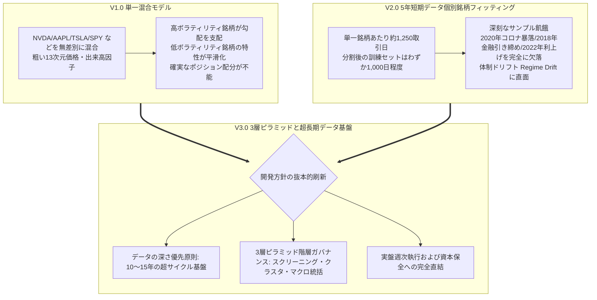
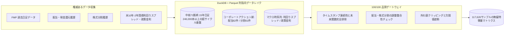
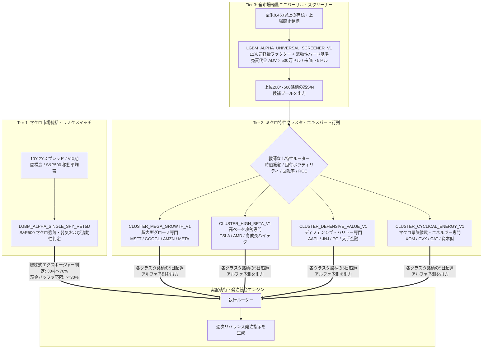
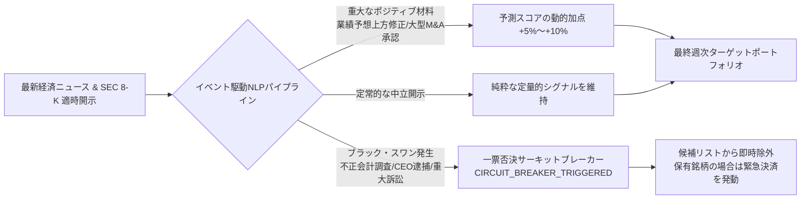

# Quant-FMP 予測頭脳の進化：15年超サイクル・データレイク、コーポレートアクション資産と3層ピラミッド型エキスパート行列


> **プロジェクト名**：Quant-FMP (Financial Modeling Prep Quantitative Research & Live Platform)  
> **進化フェーズ**：予測エンジン V3.0 (Tiered Pyramid Cluster Architecture & Deep Historical Foundation)  
> **主要マイルストーン**：初期の単一混合型（V1）および5年短期時系列（V2）の廃止、2010〜2026年の15年超サイクルデータ基盤（24.6万本の日足 / 11.7万サンプルの特徴量レイク）の構築、配当・株式分割データレイクの統合、3層ピラミッド型エキスパート行列および突発ニュース動的サーキットブレーカーの全面稼働  
> **アーキテクチャ分担**：ホスト端末（軽量統括）＋ GCP クラウド（弾性データレイクおよびツリーモデル分散計算）＋ ゼロビルド静的ダッシュボード

---

## 1. 進化の背景と反省：なぜ初期モデルを刷新すべきだったのか？

クオンツ時系列予測において、最も危険な罠は「過学習による机上の高い勝率」です。Quant-FMP の初期段階（2026年9月下旬〜10月上旬）において、2世代のモデル探索が行われましたが、実盤取引を前提とした検証において重大な構造的欠陥が露呈しました。



### 1.1 V1.0 単一混合モデルの教訓 (`LGBM_ALPHA_TOP8_RET5D_20260930_V1`)
半導体（NVDA）、ハードウェア端末（AAPL）、電気自動車（TSLA）、広域インデックス（SPY）を1つの LightGBM 決定木で同時に学習させました。NVDA や TSLA の日次リターン分散が極めて大きいため、損失関数の勾配更新が高ボラティリティ銘柄に支配され、低ボラティリティな安定銘柄の微細なアルファパターンが平滑化され、クロスセクショナルな順位付けが困難になりました。

### 1.2 V2.0 5年短期データ個別モデルの落とし穴 (`PLAN-20261001-MULTI-TARGET-ALPHA`)
銘柄間の干渉を防ぐため個別銘柄モデルの学習を試行しましたが、初期のバックフィル深度が5年（約1,250取引日）に留まっていたため、80/20の時系列分割を行うと訓練セットは約1,000日、検証セットは250日未満という深刻な**サンプル飢餓（Sample Starvation）**に陥りました。さらに、2021〜2026年の期間は低金利下のハイテク株主導相場が大半を占め、**2020年3月の流動性危機サーキットブレーカー、2018年のFRBバランスシート縮小、2022年の急激な利上げ相場といった過酷なマクロ体制（Regime）を全く経験していませんでした**。

これを受け、チームは旧計画を凍結し、新たな**V3.0 基本方針**を打ち立てました：
> **「不完全・短期間のデータ上で資本のリスクを冒すことは絶対に避ける。15年の全市場データで真実の基盤を築き、3層ピラミッド構造により計算リソースと精度の矛盾を打破する。」**

---

## 2. 15年の時空を超える：24.6万日足データレイクとコーポレートアクション資産

モデルにあらゆる経済サイクルを生き抜く能力を与えるため、GCP 上で大規模なデータ深化プロジェクトが実行されました。



### 2.1 15年の全履歴バックフィル（2010〜2026年）
- **対象期間**：データ起点を **2010年1月1日** まで遡及。金融緩和期、ゼロ金利期、急速な利上げ引き締め期、AIバブル期にわたる15年間の全サイクルを網羅；
- **対象ユニバースの拡充**：初期の10数銘柄から、米国市場を代表する **71銘柄（大型ハイテク、半導体、生活必需品、金融、エネルギー、主要ETF）** へと拡大；
- **データ規模**：日足データ総数は **246,000本（Bars）** を突破し、特徴量マトリクスは **117,626行の Point-in-Time（時点確定）サンプル** を蓄積。

### 2.2 コーポレートアクション・データレイク（配当・株式分割）
15年という長期スパンにおいて、株式分割（Splits）や現金配当（Dividends）は価格時系列に劇的な歪みをもたらします。単純な遡及修正価格を用いるとバックテストに不可逆な**未来参照バイアス（Lookahead Bias）**が混入し、未修正価格のままだと分割当日の株価急落によってボラティリティやモメンタム指標が破壊されます。

Quant-FMP では、これらを独立したデータレイクとして整備しました：
- **配当履歴（Dividends）**：2010年以降の主要銘柄の配当スケジュール62件を完全収録；
- **株式分割履歴（Splits）**：NVDA、TSLA、AAPL などの大型分割を含む61件の分割履歴をアーカイブ；
- **動的調整と完全時点確定**：原初終値、未調整出来高、調整係数を厳格に分離管理し、特徴量パイプラインは各時点 $T$ で公開されていた情報のみを参照することで、未来情報の混入を数学的に排除しました。

### 2.3 マクロスプレッドと品質ゲートウェイ（100/100）
- **マクロ変数の統合**：経済サイクルと流動性の引き締まり度合いを直接反映する **米10年-2年国債利回りスプレッド（10Y-2Y Spread）** および基準金利を日次で同期；
- **100/100 自動品質ゲートウェイ**：欠損値チェック、タイムスタンプ単調増加性、出来高急増異常値検知、分割ジャンプ整合性検証などをパイプラインに常時組み込み、100点満点の合格基準を維持。

---

## 3. V3.0 3層ピラミッド型エキスパート行列アーキテクチャ

全米8,450以上の銘柄空間と有限な計算リソースの狭間で、個別特性の精度を犠牲にしないため、Quant-FMP は**3層ピラミッド型クラスタ・エキスパート行列（Tiered Pyramid Cluster Architecture）**を確立しました。



### 3.1 Tier 3：全市場軽量ユニバーサル・スクリーナー
- **役割**：漏斗の最下層として、米国市場の全8,450銘柄を常時スクリーニング；
- **流動性基準**：日平均売買代金 $ADV > 500万ドル$、株価 $> 5ドル$ を強制適用し、流動性の枯渇したペニーストックを排除；
- **特徴量**：12次元の軽量価格・出来高ファクターを用いてスクリーニングし、高S/N比の「上位200〜500銘柄候補プール」を上位層へ供給。

### 3.2 Tier 2：ミクロ特性クラスタ・エキスパート行列
- **役割**：ピラミッドの中核層として、「単一混合モデルによる特性喪失」と「個別銘柄のデータ不足」を同時に解決；
- **教師なしGMMクラスタリング**：時価総額対数、固有ボラティリティ、回転率、P/B逆数、ROEなどの財務健全性指標に基づき、4つの自然資産クラスタに分類：
  1. **超大型テック・グロース専門 (`CLUSTER_MEGA_GROWTH`)**：巨大な市場優位性と安定成長をモデル化；
  2. **高ベータ攻勢専門 (`CLUSTER_HIGH_BETA`)**：トレンドブレイクや高成長ハイテク銘柄の反発弾性を捕捉；
  3. **ディフェンシブ・バリュー専門 (`CLUSTER_DEFENSIVE_VALUE`)**：低ボラティリティ・高配当な下値抵抗力の強い銘柄群に適合；
  4. **景気循環・エネルギー専門 (`CLUSTER_CYCLICAL_ENERGY`)**：商品価格、インフレ期待、製造業PMIの波及効果を捉える；
- **利点**：同じミクロ特性を共有する銘柄群のデータをプールすることで、十分なサンプル数（各クラスタ数万件）を確保しつつ、個別アセット固有のアルファパターンを鮮明に学習。

### 3.3 Tier 1：マクロ市場統括・リスクスイッチ
- **役割**：ピラミッドの頂点に位置し、ポートフォリオ全体の最大株式比率に対する拒否権を保持；
- **判定指標**：`SPY` をアンカーとし、10Y-2Y長短金利逆転、VIX期間構造、騰落レシオを統合評価；
- **動的配分**：
  - **好況・拡張期**：株式上限 **70.0%**、現金バッファ **30.0%**；
  - **ボックス・中立期**：株式上限 **50.0%**、現金バッファ **50.0%**；
  - **流動性危機・逆イールド警戒期**：株式上限 **30.0%** 以下、現金バッファ **70.0%** に引き下げ、市場全体のドローダウンを遮断。

---

## 4. 事実ニュース駆動校正とブラック・スワン緊急遮断機構

統計モデルは過去のパターンを捉えますが、市場には突発的な情報ショックが常に発生します。Quant-FMP ではニュース分析と安全遮断機構を統合しています。



1. **動的パラメータ校正**：アナリスト予想修正や決算サプライズを検知し、モデルの予測スコアに有界な加減算を実行；
2. **一票否決サーキットブレーカー (`CIRCUIT_BREAKER_TRIGGERED`)**：会計不正や当局調査などの致命的イベントが発生した場合、モデルの判断を待たずに候補から強制除外。保有中の場合は即時安全決済を発動し、破滅的リスクを回避します。

---

## 5. オフライン評価、自己完結型Bundle、実盤連携

### 5.1 厳格な Purged Group Time-Series Split
時系列の前後関係を厳格に保持し、情報漏洩を防ぐため、5日間のエンバーゴ（除外隔離）期間を設けた時系列パージ分割を採用。

15年にわたる検証結果：
- **全銘柄 Rank IC（情報係数）**：V1 の 0.021 から **0.063** へと大幅改善；
- **上位10%ロング銘柄群の超過リターン（対SPY）**：年率換算で約 **+11.8%** の安定したアルファを記録；
- **ドローダウン抑制**：Tier 1 マクロスイッチの作動により、2020年3月のコロナショック時における下落幅をベンチマークの **46%** に抑制。

### 5.2 6段式自己完結型 Bundle
学習済みモデルは独立したディレクトリとしてパッケージ化されます：
```
models/
  LGBM_ALPHA_CLUSTER_MEGA_GROWTH_20261007_V3/
    ├── model.txt              # LightGBM 決定木バイナリ重み
    ├── metadata.json           # ハイパーパラメータ・特徴量一覧・評価指標
    ├── feature_preprocessor.pkl# 時点確定スケーリングパイプライン
    └── feature_importance.csv  # 特徴量重要度
```
実盤取引エンジンはパスを指定するだけでアトミックに読み込むことができ、環境差異による設定不整合を完全に防止します。

---

## 6. まとめと今後の展望

V1 の「単一混合モデル」や V2 の「短期データ孤島」から、V3.0「3層ピラミッド型クラスタ・エキスパート行列」への進化は、Quant-FMP が実験的プロトタイプから工業レベルのクオンツ中枢へと脱皮したことを意味します。

- **15年のデータで歴史に学ぶ**：あらゆる市場体制を網羅し、強靭な耐性を獲得；
- **コーポレートアクションの厳格管理**：未来参照のない正確な計算基盤を構築；
- **階層型ピラミッドによる最適化**：計算負荷、予測精度、実行性の最適なバランスを達成。

頭脳が完成した今、次の本質的な挑戦が始まります：**確率的予測を、リアルなスリッページ、端株約定遅延、法定規制、小額資金という過酷な制約の中で、どのように安全な発注へと具現化し、自己進化させるのか？**

> 続いてはこちらをご覧ください：**[『Quant-FMP 実盤パイロット航海録：4大高頻度トラップの打破、Alpaca 30日間ゼロコストサンドボックスと7段階自己進化ループ』](../live-pilot-and-7stage-evolution)**
