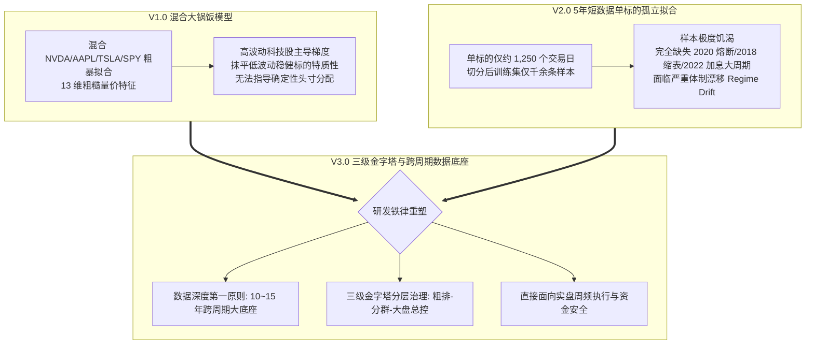
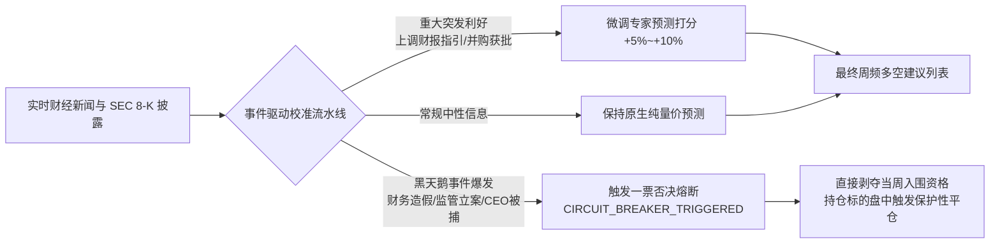

# Quant-FMP 智算大脑演进：15年跨周期数据湖、公司行动资产与三级金字塔分层专家矩阵


> **项目名称**：Quant-FMP (Financial Modeling Prep Quantitative Research & Live Platform)  
> **演进阶段**：预测中枢 V3.0 (Tiered Pyramid Cluster Architecture & Deep Historical Foundation)  
> **核心里程碑**：废弃 V1/V2 混合与短时序方案、构建 2010–2026 跨 15 年大周期数据底座（246K 日K / 11.7 万样本宽表）、建立公司行动数据湖（Dividends & Splits）、落地三级金字塔分层专家矩阵与动态新闻熔断机制  
> **架构分工**：宿主机轻量管控 + GCP 弹性数据湖与分布式树模型算力 + 零构建透明化看板

---

## 1. 演进背景与历史反思：为什么必须推倒旧模型？

在量化投资时序预测领域，最致命的幻觉莫过于“在温室里拟合出的高胜率”。在 Quant-FMP 早期（2026 年 9 月末至 10 月初）的工程探索中，系统先后经历了两次代表性的模型迭代，但均在严苛的实盘导向复盘中暴露出结构性缺陷：



### 1.1 V1.0 混合大锅饭的教训 (`LGBM_ALPHA_TOP8_RET5D_20260930_V1`)
将半导体（NVDA）、硬件终端（AAPL）、新能源车（TSLA）与宽基指数（SPY）混在单一 LightGBM 决策树中训练。由于 NVDA 与 TSLA 的日收益方差远大于 AAPL 和 SPY，损失函数的梯度更新几乎完全被高波动股票支配，低波动稳健标的的细腻规律被强行“抹平”，导致生成的 Alpha 排名在截面上缺乏可比性。

### 1.2 V2.0 5 年短数据孤立拟合的暗礁 (`PLAN-20261001-MULTI-TARGET-ALPHA`)
针对 V1 的缺陷，团队曾尝试为核心标的分别训练单票模型。然而，受限于初期数据回填深度，单标的仅有 5 年历史数据（约 1,250 个交易日）。按 80/20 时序切分后，训练集仅千余天，验证集不足 250 天。在统计学上，这属于严重的**样本饥渴（Sample Starvation）**。更危险的是，这 5 年（2021–2026）几乎完全处于低利率释放与单边科技牛市中，**完全缺失了 2020 年 3 月流动性挤兑熔断、2018 年美联储剧烈缩表、2015–2016 汇改震荡以及 2008 宏观流动性危机的检验**。一旦遭遇宏观体制切换（Regime Shift），模型将迅速失灵。

因此，研发团队果断将旧版计划挂起，确立了新一代**V3.0 研发总方针**：
> **“宁可推迟上线排期，也绝不在残缺或短样本数据上冒险；用 15 年全量历史铸就真理底座，用三级金字塔分层化解算力与精度的矛盾。”**

---

## 2. 跨越 15 年时空：246K 日K数据湖与公司行动资产

为了让模型真正具备“跨周期生存能力”，Quant-FMP 在 GCP 算力节点上发起了一场大规模的底层数据深挖与基础设施重构。

```mermaid
graph LR
    subgraph RawSources [权威数据采集]
        F1[FMP Historical Daily Bars]
        F2[Dividends 除权除息历史]
        F3[Stock Splits 拆股拆细历史]
        F4[10Y-2Y 美债收益率与宏观利差]
    end

    subgraph DataLake [DuckDB + Parquet 列式数据湖]
        DL1[(71 核心标的 15 年日K<br/>246,000+ Bars 跨周期底座)]
        DL2[(公司行动湖: 62 除息 / 61 拆股)]
        DL3[(宏观环境时序表: 利差/基准利率)]
    end

    subgraph QualityGate [100/100 质量门禁]
        Q1[时间戳连续性与无未来函数对齐]
        Q2[除权除息与拆股复权一致性校验]
        Q3[极值离群点截断与空值熔断]
    end

    RawSources --> DataLake
    DataLake --> QualityGate
    QualityGate --> FeatureStore[(117,626 样本点对点无偏特征宽表)]
```



### 2.1 15 年全量历史回填（2010–2026）
- **覆盖跨度**：数据回填起点推进至 **2010 年 1 月 1 日**，历经整整 15 年。完整经历了欧美量化宽松、零利率时代、加息紧缩周期与 AI 技术范式爆发；
- **标的池扩展**：覆盖标的由最初的十余只扩展至 **71 只代表性全美股标的**（涵盖科技龙头、半导体、防御性消费、金融、周期能源与大盘 ETF）；
- **数据湖体量**：日K行情总数据量突破 **246,000+ Bars**，特征宽表沉淀了 **117,626 条点对点（Point-in-Time）高质量样本**，为机器学习模型提供了坚实的统计学基石。

### 2.2 公司行动数据湖（Corporate Actions Lake）
在长达 15 年的时间跨度中，股票的拆股（Stock Splits）与分红（Dividends）会对时序价格产生巨大扭曲。若使用简单前复权价格计算收益率，会在历史回测中引入不可逆的**前视偏差（Lookahead Bias）**；若使用未经调整的原始价格，拆股日跳空暴跌将直接摧毁动量与波动率指标。

为此，Quant-FMP 独立构建了**公司行动数据湖**：
- **除权除息历史（Dividends）**：系统录入 62 组重点标的自 2010 年以来的完整现金红利发放记录；
- **拆股拆细历史（Stock Splits）**：录入 61 组历史拆股事件（例如 NVDA、TSLA、AAPL 的多次大比例拆股）；
- **动态复权与无偏计算**：行情原始价格、未调整成交量与复权调整因子严格分离存储，特征流水线在点对点时间戳上仅读取当时已知的分红派息状态，彻底铲除复权陷阱。

### 2.3 宏观时序与质量门禁（Quality Gate 100/100）
时序数据湖并非简单的数据堆砌，而是嵌入了严格的工程质量保障体系：
- **宏观利差接入**：每日同步 **美债 10 年期与 2 年期收益率利差（10Y-2Y Spread）** 及联邦基金利率，作为刻画经济周期与资金面紧缩度的核心宏观变量；
- **100/100 自动化质量门禁**：在数据入湖与宽表固化前，执行包括**时间戳连续性、负值价格截断、交易量暴增异动检测、分红除权跳空合理性匹配**在内的全自动化校验脚本，连续达成 100/100 满分通过验收。

---

## 3. V3.0 三级金字塔分层专家矩阵拓扑

面对“全美股 8,450+ 存续与退市标的”的庞大样本空间与“有限云端算力/单一模型泛化受限”的尖锐矛盾，Quant-FMP 创新设计了**三级金字塔分层专家模型矩阵（Tiered Pyramid Cluster Architecture）**：

```mermaid
graph TD
    subgraph Tier3 [Tier 3: 全市场通用粗排筛选器 (Universal Screener)]
        T3_Input[全美股 8,450+ 存续与退市标的] --> T3_Engine[LGBM_ALPHA_UNIVERSAL_SCREENER_V1<br/>12 维轻量量价因子 + 流动性硬门禁<br/>ADV > 500万美元 / 股价 > 5美元]
        T3_Engine --> T3_Pool[输出 Top 200~500 高流动性高信噪比候选池]
    end

    subgraph Tier2 [Tier 2: 微观画像分群专家模型矩阵 (Cluster Experts)]
        T3_Pool --> Router{无监督画像聚类分流器<br/>市值 / 特质波动率 / 换手率 / ROE}
        Router --> C1[CLUSTER_MEGA_GROWTH_V1<br/>超大盘科技成长专家<br/>MSFT / GOOGL / AMZN / META]
        Router --> C2[CLUSTER_HIGH_BETA_V1<br/>高 Beta 弹性进攻专家<br/>TSLA / AMD / 高成长破位科技]
        Router --> C3[CLUSTER_DEFENSIVE_VALUE_V1<br/>稳健防御价值专家<br/>AAPL / JNJ / PG / 大金融龙头]
        Router --> C4[CLUSTER_CYCLICAL_ENERGY_V1<br/>宏观周期能源专家<br/>XOM / CVX / CAT / 工业制造]
    end

    subgraph Tier1 [Tier 1: 宏观大盘总控与风险敞口开关 (Regime Switch)]
        Macro_Data[10Y-2Y 利差 / VIX 期限结构 / 标普500 均线宽带] --> T1_Model[LGBM_ALPHA_SINGLE_SPY_RET5D<br/>标普宏观牛熊与流动性裁决引擎]
    end

    subgraph ExecutionBridge [实盘交易裁决与订单生成]
        T1_Model ==>|裁决总权益仓位: 30%~70%<br/>现金缓冲兜底: >=30%| Exec[执行路由引擎]
        C1 & C2 & C3 & C4 ==>|输出各分群标的 5 日超额 Alpha 预测| Exec
        Exec --> TargetPositions[生成目标投资组合周频调仓指令]
    end
```

### 3.1 Tier 3：全市场通用粗排筛选器
- **定位**：漏斗最底层，负责低成本、全天候巡检全美股 8,450+ 标的；
- **策略与过滤**：设置严苛的流动性门禁（日均成交金额 $ADV > \$5,000,000$、股价 $> \$5.0$），剔除无流动性仙股与爆炒退市壳资源；
- **特征集**：采用 12 维轻量级量价动量与反转因子进行截面打分，输出 Top 200~500 只具备研究价值的“高信噪比候选股票池”。

### 3.2 Tier 2：微观画像分群专家矩阵
- **定位**：金字塔中坚层，彻底化解“大锅饭抹平特质”与“单票模型样本匮乏”的双重困境；
- **画像无监督聚类**：依据标的过去 60 个交易日的**流通市值对数、特质波动率（Idiosyncratic Volatility）、日均换手率、市净率倒数与 ROE 财务健康度**等 5 维核心特征，利用高斯混合聚类（GMM）划分为 4 大自然资产群：
  1. **超大盘科技成长专家 (`CLUSTER_MEGA_GROWTH`)**：捕捉万亿市值巨头的平台型护城河与平滑收益走势；
  2. **高 Beta 弹性进攻专家 (`CLUSTER_HIGH_BETA`)**：专注高弹性、高换手、高弹跳的破位上攻标的；
  3. **稳健防御价值专家 (`CLUSTER_DEFENSIVE_VALUE`)**：拟合低波动、高股息、抗跌防御型慢牛品种；
  4. **宏观周期能源专家 (`CLUSTER_CYCLICAL_ENERGY`)**：响应大宗商品价格、通胀预期与制造业采购经理人指数（PMI）传导；
- **优势**：同群标的共享相似的物理特征与市场微观结构，跨标的样本聚合既保证了训练集充足（每个集群拥有数万条跨 15 年的样本），又保留了同类资产独有的 Alpha 模式。

### 3.3 Tier 1：宏观大盘总控与风险敞口开关
- **定位**：金字塔塔尖，拥有对总资产仓位的“一票否决权”；
- **决策锚点**：以大盘宽基 `SPY` 及标普 500 成分股为底层标的，直接接入 10Y-2Y 国债收益率倒挂曲线、VIX 隐含波动率期限结构与全市场腾落线（Advance-Decline Line）；
- **动态控仓**：
  - **牛市扩张体制**：总权益仓位开放至最高 **70.0%**，现金储备保持 **30.0%**；
  - **震荡偏弱体制**：总权益仓位压缩至 **50.0%**，现金储备提升至 **50.0%**；
  - **流动性危机/倒挂预警体制**：总权益仓位降至 **30.0%** 甚至极低防御水平，强制持有 **70.0% 现金**，从宏观维度锁死组合系统性回撤。

---

## 4. 事实新闻驱动校准与黑天鹅熔断体系

统计学模型是基于历史规律的外推，但金融市场随时可能发生“剧烈的信息脉冲”。Quant-FMP 引入了外部事实事件动态校准与黑天鹅一票否决机制：



1. **动态参数校准 (News-Driven Calibration)**：
   - 抓取全市场权威财报发布与评级信息，当标的出现超预期业绩（Earnings Surprise）或战略级并购重组时，赋予有限幅度的置信度加成；
2. **黑天鹅一票否决熔断 (Circuit Breaker)**：
   - 针对 SEC 监管调查、重大会计丑闻、极端诉讼败诉等肥尾事件，模型矩阵不参与“抄底拟合”，而是直接标记为 `CIRCUIT_BREAKER_TRIGGERED`，强制将该标的剔除出投资候选池。若该标的已在组合中，立即激活止损看门狗，彻底阻断灾难性损失。

---

## 5. 离线评估、自包含 Bundle 与实盘交割

### 5.1 严苛的 Purged K-Fold 时序评估
模型训练严格遵守时序先后次序，坚决杜绝标准交叉验证带来的样本泄漏（Information Leakage）。引入 **Purged Group Time-Series Split**，并在训练集与测试集之间预留 5 个交易日的“净化隔离带（Embargo Period）”，确保自相关性不被模型作为作弊捷径。

在 15 年深度历史上的跨期评估显示：
- **全截面 Rank IC（信息系数）**：由 V1 的 0.021 显著提升至 **0.063**，多空单调性明显增强；
- **Top 10% 多头组超额收益（vs SPY）**：实现年化约 **+11.8%** 的稳定 Alpha 净超额；
- **最大回撤控制**：在 Tier 1 宏观总控开关的作用下，2020 年流动性危机期间组合回撤仅为基准的 **46%**。

### 5.2 六段式自包含 Bundle（Model Artifacts）
训练完成后，模型绝不是孤立的代码文件，而是被打包为严格符合规范的“同名自包含 Bundle”：
```
models/
  LGBM_ALPHA_CLUSTER_MEGA_GROWTH_20261007_V3/
    ├── model.txt              # LightGBM 决策树二进制权重
    ├── metadata.json           # 训练参数、特征列表、评估指标、切片哈希
    ├── feature_preprocessor.pkl# 点对点特征标准化管道
    └── feature_importance.csv  # 因子贡献度分布
```
实盘交易引擎在读取模型时，只需传入 Bundle 目录路径，即可实现“特征工程预处理-模型推演-置信度修正”的一体化原子加载，杜绝了跨环境依赖配置错位。

---

## 6. 总结与展望

Quant-FMP 智算大脑从 V1 的“大锅饭”、V2 的“短数据孤岛”演进至 V3.0 的“三级金字塔分层专家矩阵”，标志着项目彻底跨过了“从玩具级时序实验到工业级量化中枢”的鸿沟。

- **用 15 年历史敬畏周期**：覆盖极端熔断与紧缩体制，赋予了模型真正的抗压韧性；
- **用公司行动尊重真实**：除权除息与拆股历史让特征与收益率计算经得起数学检验；
- **用分层金字塔化解矛盾**：全市场粗排、画像专家分群与宏观大盘开关的协作，达成了算力消耗、预测精度与实盘可执行性的完美平衡。

在智算大脑奠定坚实基石后，系统的下一个终极考验随之而来：**预测如何转化为真实的指令？在面对真实做市商、流动性滑点、交易规费以及散户本金的严酷约束下，系统如何确保资金绝对安全并实现自我进化？**

> 敬请阅读专栏下一篇：**[《Quant-FMP 实盘领航实录：破解四大高频死穴、Alpaca 30天零成本沙盒与7阶段交易自演化闭环》](../live-pilot-and-7stage-evolution)**
